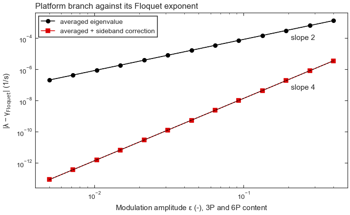
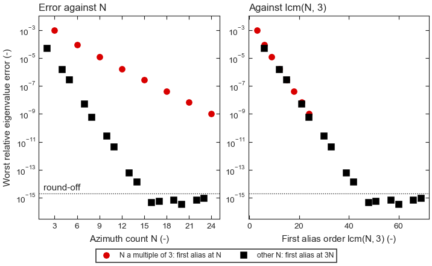
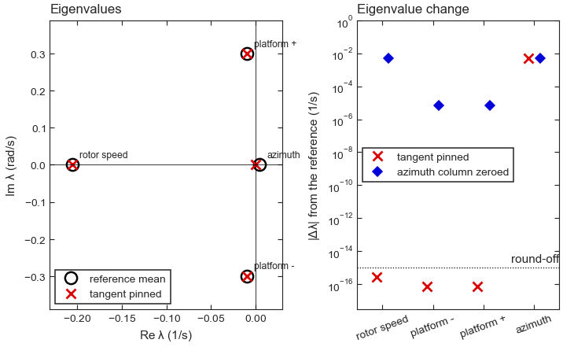
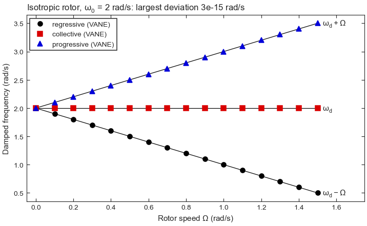

<!-- SPDX-License-Identifier: Apache-2.0 -->

# VANE verification and validation

This is the verification and validation record for VANE. It is for users and reviewers
who need the evidence behind a VANE result: each case lists its reference, the measured
result, the acceptance value and the pytest test in `tests/` that reproduces it. The
sections follow the VANE workflow: OpenFAST linearization set-up and sweep, the MBC3
transform and azimuth averaging, mode identification and tracking, Campbell diagrams,
Floquet analysis and the averaging error estimate, and state-space and LPV export.
Comparisons with OpenFAST linearizations of public reference turbines follow, and the
figures are collected at the end.

## Approach

VANE post-processes OpenFAST linearizations and drives the OpenFAST runs that produce
them. The question it must answer correctly is narrow: given the matrices OpenFAST
wrote, does VANE recover their modal content faithfully? That covers the configuration
of the linearization cases, the multi-blade coordinate (MBC3) transform, the
eigensolution, labelling and tracking, the azimuth average and its error estimate, and
the exported state-space and estimator models.

Faithful extraction is verified against references with no version ambiguity:
closed-form analytical solutions, exact mathematical invariants, systems built from
prescribed modes (the answer is constructed, not looked up), and a cross-check of two
implementations on identical `.lin` files. VANE does not use published natural
frequencies of reference turbines as acceptance values. Those values come from other
model versions and other conditions (isolated components, parked rotors, different
blade models), and a tolerance against them would test the model rather than the
extraction. Comparisons with published values are reported as plausibility checks,
with each deviation attributed to its physical cause;
`vane.validation.compare_to_reference` provides the same comparison for user models.

Case identifiers carry an evidence level:

| Level | Evidence |
|---|---|
| A | Analytical solution in closed form |
| I | Exact invariant or identity |
| P | Prescribed truth: a system constructed with a known answer |
| B | Software behaviour: rejection of invalid input, round trips, fail-fast checks |
| D | OpenFAST linearizations of public reference models (local data) |
| X | Cross-check of an independent implementation on identical `.lin` files |

Levels A, I, P and B run in the default test suite on every change. Level D tests read
OpenFAST data that is not distributed with VANE and skip unless the data is present
(see [Reproducing](#reproducing)). Level X was a manual comparison and is not part of
the test suite.

Theory and conventions are in the manual:
[MBC3 and linearization](https://vane.readthedocs.io/en/latest/theory/linearization_mbc.html),
[modal identification](https://vane.readthedocs.io/en/latest/theory/modal_identification.html),
[Floquet analysis](https://vane.readthedocs.io/en/latest/theory/floquet.html),
[azimuth averaging](https://vane.readthedocs.io/en/latest/user_guide/azimuth_averaging.html)
and the [linearization sweep](https://vane.readthedocs.io/en/latest/user_guide/linearization_sweep.html).

## Summary

| ID | Level | Case | Reference | Result | Acceptance | Status |
|---|---|---|---|---|---|---|
| RUN-1 | B | Sweep fails before any OpenFAST launch on bad input | input contract | rejected | no process launched | Pass |
| RUN-2 | B | Deck configuration from the deck and an operating curve | linearization recipe | settings written | per test | Pass |
| RUN-3 | B | Retry ladder, non-finite and non-periodic linearizations, case errors | failure modes | recorded, not accepted | per test | Pass |
| RUN-4 | B | Operating-point verification | rotor-performance curve | pass or flag per point | 5 % Cp, 0.5 deg pitch | Pass |
| MBC-1 | I | Azimuth invariance of the transformed `A`, isotropic rotor, `Omega` = 0, 0.5, 1.5 rad/s | exact invariance | ~1e-15 spread | 1e-9 | Pass |
| MBC-2 | A | Coleman split, isotropic rotor (Figure 4) | `w_d - Omega`, `w_d`, `w_d + Omega` | 1.0 / 2.0 / 3.0 rad/s at `Omega` = 1 rad/s | 0.02 rad/s | Pass |
| MBC-3 | I | Eigenvalues at zero rotor speed; analytic 3x3 inverse; `B` invariance | similarity transform; `inv()` | exact | 1e-9; 1e-12; 1e-9 | Pass |
| MBC-4 | B | Displacement/velocity pairing across modules; sweep checks | channel descriptions | all pairs formed | every pair shares a key | Pass |
| AVG-1 | I | Quadrature weights and aliasing kernel (Figure 2) | dense integration; `W(h)` identity | 1e-9; 1e-13 | per test | Pass |
| AVG-2 | I | Azimuth treatments: tangent pinning (Figure 3) | Brauer's theorem | other eigenvalues unchanged | 1e-10 | Pass |
| EIG-1 | A | Single damped oscillator | `w_n`, `zeta`, `w_d` closed form | exact | rel 1e-6 | Pass |
| EIG-2 | A | Euler-Bernoulli cantilever, first three modes | `(beta_n L)^2 / 2pi * sqrt(EI / rho A L^4)` | within 1 % | 1 %; damping 1e-9 | Pass |
| EIG-3 | P | Prescribed-mode benchmark | prescribed `wn`, `zeta`, `Phi` | below 1e-9 | 1e-9; MAC > 1 - 1e-9 (diagonal), > 0.999 (coupled) | Pass |
| MAC-1 | I | MAC and MACXP identities | unit diagonal, zero, scale invariance | exact | per identity | Pass |
| PART-1 | I | Left-right participation | scale invariance, unit sum | exact | per identity | Pass |
| LAB-1 | P | Participation-based labels | prescribed modes | correct label | exact | Pass |
| LAB-2 | P | Multi-blade type, whirl direction and numbering | prescribed rotor | every label once | exact | Pass |
| TRK-1 | P | Tracking through a frequency crossing | prescribed shapes | lines stay distinct | exact | Pass |
| UNC-1 | A | Confidence calibration and azimuth-spread uncertainty | Bernoulli link; isotropic rotor | Brier 1/6; round-off spread | per test | Pass |
| CMP-1 | A | End-to-end Coleman Campbell diagram | `w0 -/+ Omega` | within 2 % | 2 % | Pass |
| CMP-2 | A | Resonance crossing | `3 rpm / 60 = 1.5 Hz` at 30 rpm | 30 rpm, 1.5 Hz | interpolation exact | Pass |
| FLQ-1 | I | Floquet (Hill, monodromy), LTI limit and periodic systems | `eig(A)`; ODE monodromy | agree | 1e-6 to 5e-3 | Pass |
| AVG-3 | A | Averaged eigenvalue against the Floquet exponent (Figure 1) | Floquet exponent | `O(eps^2)`; `O(eps^4)` corrected | ratios 4 and 16 | Pass |
| AVG-4 | P | Terms of the error estimate, conditioning, mode mixing, alias resolution | exact sub-grid eigenvalues | within 5 % of exact | per test | Pass |
| SS-1 | A | Zero-order hold; modal realization; export round trip | `exp(lambda dt)`; prescribed modes | exact | 1e-9 freq, 1e-6 damping | Pass |
| SS-2 | A | Observability Gramians, finite horizon | quadrature; Lyapunov | 1e-8; 1e-9 rel | per test | Pass |
| SS-3 | A | Discrete process noise | direct integral; scalar closed form | 1e-10 | 1e-10 | Pass |
| SS-4 | I | Steady-state Kalman filter (`vane.sysid.assessment`) | Riccati fixed point | 1e-10 | 1e-10 | Pass |
| SS-5 | A | Balanced truncation | `2 sum(discarded sigma)` bound | below bound | H-infinity bound | Pass |
| SS-6 | P | Operating-point ROM family, scheduled filter, physical LPV family | crossing modes; blended realizations | identity kept; 1e-8 rel | per test | Pass |
| SS-7 | I | Runtime Kalman filter and smoother | noise-free data; batch posterior | near-zero error; 1e-9 | per test | Pass |
| RT-1 | D | r-test `.lin` parsing, MBC3 and modes | documented dimensions | 138 / 13 / 15 (OC4) | exact | Pass (local data) |
| RT-2 | D | r-test BeamDyn and OC3 spar labels | blade, tower and platform families | all labelled | 0.01 Hz; six platform labels | Pass (local data) |
| RT-3 | D | NREL 5 MW against NREL/TP-500-38060 Table 9-1 | Table 9-1 | 0.4 to 2.9 % land; see section | none (plausibility) | Informative |
| RWT-1 | D | Trimmed operating points, NREL 5 MW and IEA 3.4 MW | published rotor-performance curves | all points pass | Cp 3 % / 2.5 %, pitch 0.5 deg | Pass (local data) |
| RWT-2 | D | Labels and tracks on six configurations (eight with full data) | locked reference tables | every label once | 1 % frequency | Pass (local data) |
| RWT-3 | D | Heavily damped tier, IEA 15 MW monopile | rotating-frame damping | flap lines end at 8 m/s | per test | Pass (local data) |
| RWT-4 | D | IEA 22 MW BeamDyn rotor at 6 m/s | published OpenFAST stability results | 11 modes | 2 % | Pass (local data) |
| RWT-5 | D | VolturnUS-S platform periods | Allen et al. (2020) | 1 to 5 % except surge | none (plausibility) | Informative |
| RWT-6 | D | Sweeps with no settings beyond the deck and curve | sweep configured by hand | 66 of 66 points; 0.42 % | none | Recorded |
| AVG-5 | D | Stored 36-azimuth matrices, IEA 15 MW semi and OC3 spar | Floquet exponents; sub-grid eigenvalues | 1e-5 1/s; 13 of 13 hybrids | 1e-5 1/s; no false alarm | Pass (local data) |
| AVG-6 | D | Further linearizations on 8 to 18 azimuths | 72-azimuth reference | no branch accepted outside tolerance | 1 % damping, 0.1 % frequency | Pass (local data) |
| AVG-7 | D | Reference-turbine linearizations | exact sub-grid shifts | see section | per test | Pass (local data) |
| XC-1 | X | Independent MBC3 and eigenanalysis on identical `.lin` | second implementation | 6e-6 Hz (OC4); 1.9e-4 Hz (land) | none | Recorded |

**Pass** meets the stated acceptance value in the test suite. **Pass (local data)**
meets it in a test that skips without its data. **Informative** is a plausibility
comparison without an acceptance value. **Recorded** is a measured result that is not
reproduced by the test suite.

## Reproducing

```bash
pytest                                                # the full suite with coverage
pytest --no-cov tests/test_io/test_mbc_transform.py   # one file, without the coverage threshold
pytest --no-cov -rs tests/test_modal/test_reference_label_tables.py   # list skip reasons
PYTHONPATH=src python docs/validation/make_figures.py # regenerate the figures
```

Level D tests skip with a message naming the variable that enables them:

| Variable | Content | Used by |
|---|---|---|
| `VANE_RTEST_DIR` | Local clone of the OpenFAST `r-test` repository | `tests/conftest.py` fixtures (RT cases) |
| `VANE_REFERENCE_RUNS_DIR` | Reference-turbine sweep output, `<configuration>/cases/ws<wind>/` | RWT cases; the operating-point and constant tests also read the rotor-performance curves (`nrel5mw_curve.csv`, `iea3p4_curve.csv`, `iea10_curve.csv`, `iea15_curve.csv`) from a `_performance` folder beside it |
| `VANE_REFERENCE_FULL=1` | Also run the large floating and rotor-only label tables (0.5 to 1.7 GB per operating point) | `tests/test_modal/test_reference_label_tables.py` |
| `VANE_AVERAGING_ARCHIVE` | Stored 36-azimuth matrices, `<system>_u<wind>/azimuth_matrices.npz` | `tests/test_modal/test_averaging_regression.py` |
| `VANE_AVERAGING_RUNS` | Further azimuth grids, `<point>/N<count>_off<offset>/azimuth_matrices.npz` | `tests/test_modal/test_averaging_regression.py` |
| `VANE_REFERENCE_TURBINES` | Reference-turbine `.lin` files, `<configuration>/ws<wind>/` | `tests/test_modal/test_averaging_reference_turbines.py` |

No OpenFAST input deck, `.lin` file or reference-turbine output is committed. Synthetic
`.lin` data for the default suite is generated in `tests/conftest.py`. The figures are
computed from synthetic systems by `docs/validation/make_figures.py`, with the same
constructions as the tests named in their captions.

## 1. OpenFAST linearization set-up and sweep

`vane.run.run_operating_sweep` writes and runs the OpenFAST linearization cases. The
tests below exercise it with OpenFAST stubbed out; they check what VANE writes and how
it treats each outcome, not OpenFAST itself. Its results on real decks are in
[section 8](#8-reference-turbine-sweeps).

**RUN-1. Fail before launch.** Empty, duplicate, non-finite or negative wind lists,
partial or mismatched operating curves, a missing template deck or root, a positive-wind
point without a usable InflowWind file, a missing rated wind speed for a rotating trim,
an option that cannot be linearized, and a deck with no compatible OpenFAST executable
are rejected before any case is copied or any process starts.
*Tests:* `tests/test_run/test_auto_sweep.py::TestFailFastValidation`,
`tests/test_run/test_auto_sweep_configuration.py::TestFailBeforeLaunch`,
`tests/test_run/test_lin_config.py::TestRatedWindSpeedRequired`.

**RUN-2. Configuration from the deck and an operating curve.** With only a deck and its
rotor-performance curve, every case is configured: `CalcSteady` with `NLinTimes = 36`;
torque trim below rated and pitch trim above rated against constant generator torque;
`YawDOF` and `DrTrDOF` off and the blade and tower flexibility DOFs on (overridable
through `structural_dofs`); `TrimTol = 1e-3 (R / 63 m)^3` within `[1e-3, 1e-2]` and
pitch trim gain `2e-4 (63 m / R)^3`; floating trims of 20 slowest platform periods and a
settle confirmation of 8 platform periods; and module settings that make the deck
linearizable (for example uniform inflow, with deck keywords matched case-insensitively
so an InflowWind `PLexp` spelling is found, and unsteady aerodynamics ending inboard of
the tip under tip loss). Missing state-space radiation data is fitted per case. On the
reference decks the inferred rated wind speeds are 9.8127, 10.7577 and 10.6594 m/s for
the IEA 3.4, 10 and 15 MW turbines, the rated torque matches the published value to
1e-6 relative, and the r-test NREL 5 MW land deck gets 12.121 m/s and 43,093.5 N·m from
its rotor-performance curve.
*Tests:* `tests/test_run/test_auto_sweep_configuration.py::TestNoArgumentSweep`,
`tests/test_run/test_auto_config.py::TestAutoConfigureSweep`,
`tests/test_run/test_auto_config.py::TestTrimTolerance`,
`tests/test_run/test_auto_config.py::TestPitchTrimGain`,
`tests/test_run/test_lin_config.py::TestConfigureStructuralDofs`,
`tests/test_run/test_lin_config.py::TestConfigureOffshore`,
`tests/test_run/test_lin_config.py::TestConfigureServodynTorque`,
`tests/test_run/test_lin_config.py::TestConfigureRotating::test_differently_cased_shear_keyword_is_set`,
`tests/test_io/test_fst_writer.py::TestSet::test_keyword_match_is_case_insensitive`,
`tests/test_run/test_preflight.py::TestUnsteadyAeroAtTheTip`,
`tests/test_run/test_floating_sweep.py::TestFloatingTrimTime`,
`tests/test_run/test_settle_robust.py::TestAutomaticConfirmationLength`,
`tests/test_run/test_auto_config.py::test_reference_turbine_constants` and
`tests/test_run/test_auto_config.py::test_nrel5mw_rtest_torque_from_the_curve` (need `VANE_REFERENCE_RUNS_DIR`; the second also `VANE_RTEST_DIR`).

**RUN-3. Outcomes of a case.** The retry ladder chooses the next attempt from the failure
mode: a timed-out trim gets more time and never a tolerance looser than 1e-2, motoring
and divergence reduce gains and damping, and initialization errors are not retried; an
above-rated trim falls back to torque trim at the curve pitch on the last attempt. A
converged run whose `.lin` files hold NaN is recorded as not converged and not retried;
a sweep whose rotor speed drifts beyond the MBC3 limit across the azimuths is retried
with a tighter tolerance and more time instead of being accepted. An unexpected
exception in one case is recorded and the other cases complete. In a floating settle, a
bounded oscillation about a confirmed equilibrium settles with a warning, a growing one
about a confirmed equilibrium settles with the `growing_oscillation` flag, and a shifted
mean or an oscillation above the RMS bound fails.
*Tests:* `tests/test_run/test_driver.py::TestAdaptiveRetryPolicy`,
`tests/test_run/test_driver.py::TestFinalFallback`,
`tests/test_run/test_driver.py::TestNonFiniteLinearization`,
`tests/test_run/test_driver.py::TestNonPeriodicSweep`,
`tests/test_run/test_driver.py::TestCaseErrorRecording`,
`tests/test_run/test_auto_sweep.py::TestCaseErrorsInOperatingSweep`,
`tests/test_run/test_settle_robust.py::TestSustainedOscillation`.

**RUN-4. Operating-point verification.** `vane.run.verify_operating_points` compares each
trimmed point with the rotor-performance curve: rotor speed, pitch, and power from the
steady shaft-torque balance, or AeroDyn's rotor power when the deck applies trim
damping (a point trimmed 10 % low in torque with trim damping reports zero Cp deviation
from AeroDyn's power, and -10 % from the torque balance without it). The curve's `cp`
and `ct` columns are read as fractions or as declared percentages; an undeclared
percentage, fractions declared as percent and any other unit are rejected.
*Tests:* `tests/test_run/test_trim_verification.py::TestVerifyOperatingPoints`,
`tests/test_run/test_trim_verification.py::TestTrimDamping`,
`tests/test_run/test_trim_verification.py::TestCoefficientUnits`.

## 2. MBC3 transform and azimuth averaging

**MBC-1. Azimuth invariance.** For an isotropic rotor the MBC3-transformed state matrix
is the same at every azimuth. VANE reproduces this to about 1e-15 at rotor speeds of 0,
0.5 and 1.5 rad/s (test tolerance 1e-9). A transform that dropped the
velocity-coupling block would fail this check whenever `Omega` is non-zero. The
transformed input matrix `B` of an isotropic rotor with rotating blade inputs is also
azimuth-invariant (1e-9), which covers the `B`/`C`/`D` path.
*Tests:* `tests/test_io/test_mbc_transform.py::TestMbc3Mathematics::test_a_is_azimuth_invariant`,
`tests/test_io/test_mbc_transform.py::TestMbc3Mathematics::test_b_transform_is_azimuth_invariant`.

**MBC-2. Coleman split.** Three identical blade oscillators with damped frequency `w_d`
give a collective mode at `w_d` and a regressive/progressive pair at `w_d - Omega` and
`w_d + Omega`. At `Omega = 1` rad/s and `w0 = 2` rad/s (damping ratio 0.02) the damped
frequencies of the averaged model are 1.0, 2.0 and 3.0 rad/s (tolerance 0.02 rad/s).
Figure 4 repeats the construction over rotor speeds from 0 to 1.5 rad/s: the three
lines follow the analytical frequencies with a largest deviation of 3e-15 rad/s.
*Tests:* `tests/test_io/test_mbc_transform.py::TestMbc3Mathematics::test_regressive_progressive_frequency_split`,
`tests/test_io/test_mbc_transform.py::TestMbc3Mathematics::test_average_equals_single_azimuth_for_isotropic_rotor`.

**MBC-3. Exact identities.** At zero rotor speed the transform is a similarity
transform and preserves the eigenvalues (1e-9). The closed-form inverse of the 3x3
multi-blade matrix matches a numerical inverse to 1e-12.
*Tests:* `tests/test_io/test_mbc_transform.py::TestMbc3Synthetic::test_zero_speed_preserves_eigenvalues`,
`tests/test_io/test_mbc_transform.py::TestMbc3Mathematics::test_tt_inverse_matches_numerical_inverse`.

**MBC-4. State layout and sweep checks.** The `[q2, q2dot, q1]` reordering pairs each
displacement with its velocity from the channel descriptions: the ElastoDyn and BeamDyn
`First time derivative of` marker, MoorDyn `Px`/`Vx` node states, ServoDyn
structural-control states written `state X  m` / `state dX/dt  m/s`, and SubDyn
rigid-body states that carry derivative order 0 for both members. Every formed pair is
checked to share a key. The sweep is rejected for duplicate azimuths (including
wrap-around) and for a rotor-speed spread above 1 % across the azimuths; uneven,
clustered and single-azimuth rotating sweeps are warned about.
*Tests:* `tests/test_io/test_mbc_transform.py::TestStateLayoutMultiModule`,
`tests/test_io/test_mbc_transform.py::TestSweepValidation`,
`tests/test_io/test_mbc_transform.py::TestAzimuthCoverage`.

`vane.modal.averaging` forms the azimuth-averaged model from the delivered azimuths.
The checks below cover the averaging rule and the treatment of the rotor-azimuth state;
the error of the average is estimated in [section 5](#5-floquet-analysis-and-the-averaging-error-estimate).

**AVG-1. Quadrature and aliasing.** The interval weights integrate the periodic
piecewise-linear interpolant exactly (1e-9 against dense integration), and the exact
Fourier coefficients of the interpolant match numerical integration, including the
series branch for near-coincident azimuths (1e-8). On a uniform grid the weight kernel
satisfies `W(h) = exp(i h psi0)` when `N` divides `h` and vanishes otherwise (1e-13),
so a uniform `N`-azimuth mean is aliased only by harmonics that are multiples of `N`.
After MBC3 an isotropic `B`-bladed rotor carries content only at multiples of `B`, so
the first alias of the mean is at `lcm(N, B)`. On a model with 3P and 6P content the
7-azimuth mean equals the exact mean to 1e-14, and the 6-azimuth mean differs from it by
exactly the aliased 6P term. The kernel form of the sub-grid error equals the
brute-force sub-grid mean error to 1e-10 relative on uneven 36-azimuth grids. Figure 2
shows the consequence for a three-bladed rotor with geometrically decaying content at
3P, 6P, 9P and above: counts that are multiples of three are first aliased at `N`, the
others at `3N`, and all errors fall on one curve when plotted against `lcm(N, 3)`.
*Tests:* `tests/test_modal/test_averaging.py::TestIntervalWeights`,
`tests/test_modal/test_averaging.py::TestWeightKernel`,
`tests/test_modal/test_averaging.py::TestFitHarmonics`,
`tests/test_modal/test_averaging.py::TestGridErrorMatrix`.

**AVG-2. Azimuth treatments.** The rotor-azimuth position state makes coarse grids fail
non-perturbatively; `vane.modal.averaging.pin_azimuth` removes it by pinning the orbit
tangent. On a four-state periodic rotor model sampled at 36 uneven azimuths, pinning
makes the tangent a null vector of every sample (1e-12), gives every sub-grid mean a
zero eigenvalue and the periodic model a unit Floquet multiplier (1e-10), and leaves
every other eigenvalue of the mean unchanged (1e-10, Brauer's theorem). Zeroing the
azimuth column instead changes the reference, and deleting the azimuth state equals
zeroing it less the zero eigenvalue (1e-12). Figure 3 shows the spectrum: pinning moves
the azimuth eigenvalue from 0.0048 1/s to zero and changes the others by less than
1e-15, while zeroing the column moves the platform pair by 7e-6 1/s and the
rotor-speed eigenvalue by 5e-3 1/s.
*Tests:* `tests/test_modal/test_averaging.py::TestAzimuthTreatments`.

## 3. Eigensolution and mode identification

**EIG-1. Second-order oscillator.** For `A = [[0, 1], [-w0^2, -2 zeta w0]]` the
eigensolver returns `w_n = w0`, `zeta = -Re(lambda) / |lambda|` and
`w_d = w0 sqrt(1 - zeta^2)` (relative 1e-6). The eigenvalue condition number
`kappa = 1 / |y^H x|` is 1 for a normal matrix and about 5 for
`[[-0.1, 10], [-0.1, -0.1]]`; repeated eigenvalues are flagged degenerate and unstable
and over-damped eigenvalues are counted.
*Tests:* `tests/test_modal/test_eigensolver.py::TestComputeModes::test_single_oscillator_matches_analytics`,
`tests/test_modal/test_eigensolver.py::TestRobustEigenCore`.

**EIG-2. Euler-Bernoulli cantilever.** A consistent-mass finite-element model of a
uniform clamped-free beam, cast into `[[0, I], [-M^-1 K, 0]]`, gives its three lowest
frequencies within 1 % of `f_n = (beta_n L)^2 / (2 pi) sqrt(EI / (rho A L^4))` with
`beta_n L = 1.875104, 4.694091, 7.854757`, and zero damping ratios (1e-9).
*Test:* `tests/test_validation/test_cantilever_beam.py::TestCantileverBeam`.

**EIG-3. Prescribed-mode benchmark.** `vane.benchmark` builds
`[[0, I], [-K, -C]]` with `K = Phi diag(wn^2) Phi^-1` and `C = Phi diag(2 zeta wn) Phi^-1`.
Extraction recovers the prescribed frequencies and damping ratios to below 1e-9, for
diagonal and coupled `Phi`, and the mode shapes with MAC above `1 - 1e-9` (diagonal)
and above 0.999 (coupled). Under seeded Gaussian noise on the stiffness and damping
blocks the error is zero without noise and grows monotonically with the noise level.
*Tests:* `tests/test_benchmark/test_benchmark.py::TestScoreRecovery`,
`tests/test_benchmark/test_benchmark.py::TestRobustness`.

**MAC-1.** A mode set correlated with itself has a unit-diagonal MAC matrix; orthogonal
shapes give zero; MAC is invariant to complex scaling of each mode. The pole-weighted
MACXP self-correlation is exactly 1, and an undamped pole gives a NaN row and column
rather than a misleading zero.
*Tests:* `tests/test_modal/test_mac.py::TestComputeMac`, `tests/test_modal/test_mac.py::TestComputeMacxp`.

**PART-1.** The left-right participation `p_ik = |conj(y_ik) x_ik| / sum_j |conj(y_jk) x_jk|`
sums to one and is invariant to diagonal scaling of the states. BeamDyn nodal
translations are scaled by the blade length before they are compared with rotations;
on the r-test NREL 5 MW BeamDyn model the unscaled translations of the first flap and
edge modes are 20 to 50 times the rotations, and the scaled ones are comparable.
*Tests:* `tests/test_modal/test_biorthogonal.py::test_participation_is_invariant_to_diagonal_state_scaling`,
`tests/test_modal/test_participation.py::TestBeamDynScaleFactors`,
`tests/test_modal/test_participation.py::test_rtest_beamdyn_translations_become_comparable` (needs `VANE_RTEST_DIR`).

**LAB-1. Classification and labels.** State descriptions map to physical DOF
categories from their `DOF_*` tokens (for example `DOF_R` platform roll against `DOF_RFrl`
rotor furl), and BeamDyn nodal states from their component in the blade frame. A mode
is named by the classified category with the largest participation when classified
DOFs carry at least `min_known_participation` (default 0.5); its confidence is that
category's share. A synthetic tower mode that drives thirty one-way-coupled module
states is labelled 1st Tower Fore-Aft with confidence 1, although those states dominate
its raw eigenvector magnitude; a mode whose participation sits in unclassified states
stays Unidentified.
*Tests:* `tests/test_config/test_dof_map.py::TestClassifyDof`,
`tests/test_modal/test_labeler.py::TestParticipationLabelling`.

**LAB-2. Multi-blade type and numbering.** Blade modes are typed from the MBC
coordinates: collective against cyclic from the coordinates that carry the mode, and
the whirl direction from the sign of `Im(q_s conj(q_c))`, which is invariant to the
overall phase. A prescribed isotropic three-blade BeamDyn rotor with 1st to 3rd flap,
1st and 2nd edge and 1st torsion shapes is labelled exactly (every family, order and
whirl type once); a blade with only its 2nd and 3rd flap modes is numbered 2nd and 3rd.
A hybrid of two families is reported ambiguous with its runner-up, each blade family
has one collective, one regressive and one progressive member, and results do not
depend on the state or solver mode order.
*Tests:* `tests/test_modal/test_labeler.py::TestBladeMultiblade`,
`tests/test_modal/test_beamdyn_labels.py::TestBeamDynRotorLabels`,
`tests/test_modal/test_beamdyn_labels.py::TestSingleBladeLabels`,
`tests/test_modal/test_identification_hard_cases.py::TestCategoryAmbiguity`,
`tests/test_modal/test_identification_hard_cases.py::TestWhirlSlots`,
`tests/test_modal/test_identification_hard_cases.py::TestDeterminism`.

**TRK-1. Tracking.** Mode lines are the globally optimal continuity path through the
sweep over the MAC and frequency-continuity affinity. A tower-shaped mode rising from
1.0 to 1.5 Hz and a drivetrain-shaped mode falling from 2.0 to 1.4 Hz stay distinct
through their crossing. Each track reports its weakest-link MAC and flags ambiguous
continuations; a line keeps its identity through a near-coincident, mixed pair.
*Tests:* `tests/test_modal/test_identifier.py::TestIdentifyModes::test_frequency_crossing_tracked_by_shape`,
`tests/test_modal/test_identifier.py::TestGlobalTrackQuality`,
`tests/test_modal/test_identification_hard_cases.py::TestNearCoincidentTracking`,
`tests/test_modal/test_identification_hard_cases.py::TestTrackFlags`.

**UNC-1. Calibration and uncertainty.** `calibrate_confidence` recovers a known link
`P(correct) = g(confidence)` from Bernoulli samples: the identity gives a near-zero
calibration error and the analytic Brier score 1/6, and an over-confident `g(c) = c^2`
is detected and corrected. The azimuth-spread uncertainty of an averaged mode (its
first-order eigenvalue perturbation across the per-azimuth matrices) is at round-off
level for an isotropic rotor (accepted below 1e-6) and about 1e-4 for blades at 1.8,
2.0 and 2.2 rad/s.
*Tests:* `tests/test_modal/test_confidence_calibration.py::TestCalibrateConfidence`,
`tests/test_modal/test_uncertainty.py::TestAzimuthSpread`.

## 4. Campbell diagrams

**CMP-1. End-to-end Coleman Campbell diagram.** MBC3, eigenanalysis, tracking and
Campbell assembly on an isotropic rotor swept over `Omega` give three tracked lines that
match `{w0 - Omega, w0, w0 + Omega}` within 2 % at every rotor speed, with the
regressive line falling, the progressive line rising and both labelled accordingly. A
programmatic land-turbine model (tower 0.32 Hz, drivetrain 1.70 Hz, flap triplet
0.69 Hz) run through `vane.study` reproduces its baselines within 2 % and records its
provenance.
*Tests:* `tests/test_validation/test_coleman_campbell.py::TestColemanCampbell`,
`tests/test_validation/test_reference_models.py::TestReferenceLandTurbine`.

**CMP-2. Excitation lines and resonance.** The `nP` line is `n rpm / 60` Hz (1P at
60 rpm is 1 Hz). A mode at a constant 1.5 Hz crosses the 3P line at 30 rpm, and the
detector recovers (30 rpm, 1.5 Hz) by interpolation between operating points.
*Tests:* `tests/test_campbell/test_excitation.py::TestExcitationFrequencies`,
`tests/test_campbell/test_excitation.py::TestFindResonances::test_detects_interpolated_crossing`.

Plot functions have no analytical reference and are checked structurally (one line per
track, `nP` lines, resonance markers, rejection of invalid mode indices).
*Test:* `tests/test_viz/test_plots.py::TestPlotCampbell`.

## 5. Floquet analysis and the averaging error estimate

**FLQ-1. Floquet analysis.** For an azimuth-invariant `A` the Hill and monodromy
exponents equal `eig(A)` and the Hill mode shape lies in the fundamental harmonic
(sidebands below 1e-6 of it). On a periodic system the two methods agree within 5e-3
inside the fundamental strip, and above `Omega/2` the Hill method returns the true
frequency where the monodromy folds it. Inside the 0.5P parametric-resonance tongue of a
damped Mathieu oscillator, unstable or stable, both real-multiplier families are kept
and match exponents from an ODE-integrated monodromy matrix to 1e-6. The averaging
error is below 1e-6 for an isotropic system and above 1e-3 for a strongly anisotropic
one. The Hill method rejects an azimuth grid with an interval more than a relative 1e-3
from the mean interval, naming the interval, and accepts a deviation of 5e-4; on the
rejected grid the monodromy exponents of an azimuth-invariant `A` equal `eig(A)` to
1e-9.
*Tests:* `tests/test_modal/test_floquet.py::TestLtiLimit`,
`tests/test_modal/test_floquet.py::TestHillVersusMonodromy`,
`tests/test_modal/test_floquet.py::TestParametricResonance`,
`tests/test_modal/test_floquet.py::TestAveragingError`,
`tests/test_modal/test_floquet.py::TestHillUniformGrid`.

`vane.modal.averaging_error_estimate.estimate_averaging_error` returns an
`AveragingErrorEstimate` with one `BranchErrorEstimate` per branch: sampling,
quadrature and periodicity terms, the eigenvalue condition number
(`well_conditioned`, against `max_condition = 1e3`), mode mixing, and
`within_tolerance` against `damping_tolerance_pct = 1.0` and
`frequency_tolerance_pct = 0.1`. The azimuth consistency check reports an
`assessment` of `consistent`, `inconsistent-but-harmless` or `inconsistent-and-risky`,
also available as `AveragingErrorEstimate.azimuth_assessment`.

**AVG-3. Averaged eigenvalue against the Floquet exponent.** A four-state rotor model is
built about an exact periodic orbit, with 3P and 6P content of amplitude `eps`, so one
Floquet exponent is exactly zero. The averaged eigenvalue of the platform branch misses
its Floquet exponent at second order in `eps`, and the sideband-corrected value at
fourth order: halving `eps` divides the errors by 4 (accepted 3.5 to 4.5) and by about
16 (accepted 12 to 20). Figure 1 extends this over `eps` from 0.005 to 0.4, with the
Floquet exponent from an integrated monodromy matrix: the fitted slopes are 2.00 and
4.00, and at `eps = 0.4` the corrected error (3.5e-6 1/s) is 370 times smaller than the
averaged one (1.3e-3 1/s). The consistency check passes on the periodic orbit; a
spurious azimuth stiffness is flagged with an exponent equal to the integrated Floquet
exponent to 1e-6; in a saddle the growing root is reported; and a positive rotor-speed
damping is a growing but consistent pair. The graded assessment separates a residual a
decade below the platform branch (harmless) from one within it (risky).
*Tests:* `tests/test_modal/test_averaging.py::TestSidebandCorrection`,
`tests/test_modal/test_averaging.py::TestAzimuthConsistency`.

**AVG-4. Terms of the estimate.** The sampling, quadrature and periodicity terms agree
with exact eigensolutions within 5 %, 5 % and 10 %. The structured predictor is exact
for a pure azimuth-column error (1e-10) and flags the hybridization of a platform
branch with an aliased azimuth pendulum, which second-order perturbation misses; first-
and second-order predictors err at `O(E^2)` and `O(E^3)`. A branch above
`max_condition` is not `well_conditioned` and not `within_tolerance`, and the bound
`kappa ||E||_2` covers the exact shift. The mode-mixing check catches two branches
aliasing into each other that the azimuth-structured flag misses, and stays quiet under
weak coupling. A count whose first alias `lcm(N, B)` exceeds the resolved order is never
accepted: on a model with geometric 3P content, 7, 8 and 10 azimuths are alias-free
(error below 1e-9), multiples of three are not, and a 36-azimuth reference (resolved
order 17) accepts 6 azimuths but not 7. Growing sensitivity without a tail model is
reported unresolved.
*Tests:* `tests/test_modal/test_averaging_error_estimate.py::TestPredictBranchShift`,
`tests/test_modal/test_averaging_error_estimate.py::TestAveragingErrorEstimate`,
`tests/test_modal/test_averaging_error_estimate.py::TestConditioning`,
`tests/test_modal/test_averaging_error_estimate.py::TestModeMixing`,
`tests/test_modal/test_averaging_error_estimate.py::TestUnresolvedGrids`,
`tests/test_modal/test_averaging_error_estimate.py::TestAzimuthCountRule`,
`tests/test_modal/test_averaging_error_estimate.py::TestAliasTail`.

## 6. State-space and LPV export

**SS-1. Discretization and modal realization.** Zero-order-hold discretization gives
discrete eigenvalues `exp(lambda dt)`. The real block-diagonal modal realization has
exactly the given modes and their conjugates as eigenvalues; prescribed frequencies and
damping ratios realized and solved again return the same frequencies (1e-9) and damping
ratios (1e-6), and a modal solution round-trips through the export. A low labelling
confidence inflates the initial Kalman covariance of that mode.
*Tests:* `tests/test_sysid/test_state_space.py::TestDiscretization::test_discrete_eigenvalues_are_exponentials`,
`tests/test_sysid/test_modal_to_ss.py::TestModalStateSpace::test_block_eigenvalues_match_modes`,
`tests/test_sysid/test_modal_to_ss.py::TestModalFromSolution::test_from_solution_round_trips_eigenvalues`,
`tests/test_validation/test_state_space_export.py::TestStateSpaceExportFidelity`,
`tests/test_sysid/test_covariance_init.py::TestCovariancesFromConfidence::test_low_confidence_inflates_initial_variance`.

**SS-2. Observability.** The finite-horizon Gramian (Van Loan block exponential)
matches the direct integral of `e^(A^T t) C^T C e^(A t)` to 1e-8, converges to the
Lyapunov Gramian for a stable system, and stays symmetric positive semi-definite with
unstable modes. The window is split into `2^k` sub-intervals and recombined by doubling;
a lightly damped oscillator with a -60 rad/s mode over 12 and 20 s matches quadrature to
1e-9 relative, and a Gramian that overflows raises `ValueError`. The discrete Gramian
matches its direct sum (1e-9), and inverse-noise weighting scales it as the Fisher
information. Per-mode scores equal the Gramian's diagonal blocks. The
load-reconstructability check returns 0 for a load in the blind subspace, 1 for an
observed load and 0.5 for an equal split; its noise amplification scales linearly with
the measurement noise and is independent of the state basis. Constrained sensor
selection respects required and forbidden channels, budgets and group caps.
*Tests:* `tests/test_sysid/test_observability.py::TestFiniteHorizonGramian`,
`tests/test_sysid/test_observability.py::TestObservabilityGramian::test_noise_weighting_scales_the_information`,
`tests/test_sysid/test_observability.py::TestObservabilityScores`,
`tests/test_sysid/test_observability.py::TestLoadReconstructability`,
`tests/test_sysid/test_observability.py::TestConstrainedSensorSelection`.

**SS-3. Process noise and disturbance models.** `Qd = integral_0^dt e^(A s) Qc e^(A^T s) ds`
matches the direct integral to 1e-10 and the scalar closed form
`q (1 - e^(-2 a dt)) / (2 a)`, and is defined for unstable `A`. Doubling keeps it
finite: `a = -1000` gives 5e-4 and `a = -1e-16` gives `q dt`. Random-walk and harmonic
disturbance models (eigenvalues `+/- i w`) augment the state space with the expected
block structure. One covariance rule, invariant to channel units, is applied by every
entry point: symmetry relative to `sqrt(|M_ii| |M_jj|)` and definiteness of the
correlation matrix; the same matrix is accepted or rejected identically everywhere and
under scaling by 1e-15 to 1e15.
*Tests:* `tests/test_sysid/test_process_noise.py::TestDiscretizeProcessNoise`,
`tests/test_sysid/test_augmentation.py::TestAugmentWithDisturbance`,
`tests/test_sysid/test_covariance_validity.py::TestMeasurementNoiseConsistency`,
`tests/test_sysid/test_covariance_validity.py::TestProcessNoiseConsistency`.

**SS-4. Steady-state estimator.** `vane.sysid.assessment.steady_state_estimator`
solves the discrete Riccati equation. The covariances satisfy `P- = Ad P+ Ad^T + Qd` and
`P+ = (I - K C) P-` to 1e-10, both are symmetric positive semi-definite with
`P- >= P+`, and an undetectable system is rejected with both possible causes named.
`assess_load` returns the per-load error `sqrt(L P+ L^T)` and checks it against an
optional tolerance (`within_tolerance`).
*Tests:* `tests/test_sysid/test_assessment.py::TestSteadyStateEstimator`,
`tests/test_sysid/test_assessment.py::TestAssessLoad`.

**SS-5. Model reduction.** Balanced truncation gives Hankel singular values
`sqrt(eig(Wc Wo))`; the full-order balanced realization has `Wo = diag(sigma)`; the
worst frequency-response error of the truncated model stays below `2 sum(discarded
sigma)`, including on a lightly damped 25-DOF chain whose Lyapunov solutions are
numerically indefinite. Unstable systems and non-minimal orders are rejected.
*Test:* `tests/test_sysid/test_balanced.py::TestBalancedTruncation`.

**SS-6. Operating-point families.** `build_rom_family` keeps a tracked mode index on the
same physical mode across a crossing where the residue ranking flips, recovers a mode
that drops below the top residue rank, phase-aligns and scales the realizations so that
blending a five-DOF chain with a random similarity transform of itself reproduces the
frequency response to 1e-8 relative, and reports physical damping for a mode that turns
unstable while storing a stable realization. `schedule_model` returns a member exactly
at its operating point, the linear blend at a midpoint, and the clamped nearest member
flagged `extrapolated` outside the range; `run_scheduled_filter` records the tracking
MAC and warns on low confidence or extrapolation. The physical LPV family of
`vane.sysid.physical_lpv.build_physical_lpv_family` is checked structurally: derivative
pairing of the physical states, and a check that rejects a reduction which drops a
coupling the model needs. A physical LPV family saved with `save_lpv_family` reloads
with identical arrays, data types and names, and an archive of another schema version,
without one, or altered after saving is rejected.
*Tests:* `tests/test_sysid/test_rom_family.py::TestBuildRomFamily`,
`tests/test_sysid/test_lpv.py::TestScheduleModel`,
`tests/test_sysid/test_lpv.py::TestRunScheduledFilter`,
`tests/test_sysid/test_physical_lpv.py::TestBuildPhysicalLpvFamily`,
`tests/test_sysid/test_physical_lpv.py::TestDerivativePairing`,
`tests/test_sysid/test_physical_lpv.py::TestDroppedCouplingGate`,
`tests/test_sysid/test_serialize_lpv.py::TestRoundTrip`,
`tests/test_sysid/test_serialize_lpv.py::TestSchemaVersion`.

**SS-7. Runtime filter.** With zero-order-hold timing and non-zero `B` and `D`,
noise-free data is reconstructed to near-zero error by `run_filter`,
`KalmanFilter.step` and `SteadyStateKalmanFilter`, and noisy data gives consistent
normalized innovations; the RTS smoother equals the batch posterior to 1e-9. A
well-tuned filter passes the consistency test and an over-confident one is flagged.
The normalized innovations of measurements rejected by the outlier test stay in the
consistency statistics, with the rejection threshold set per step from the number of
channels used, and the rejection rate is nominal on partially reporting steps.
*Tests:* `tests/test_sysid/test_kalman_filter.py::TestZohControlTiming`,
`tests/test_sysid/test_kalman_filter.py::TestFilterConsistency`,
`tests/test_sysid/test_kalman_filter.py::TestGatedConsistency`,
`tests/test_sysid/test_kalman_filter.py::TestGateProbability`.

These are software, dimensional and linear-model checks. The physical accuracy of a
reconstructed load under nonlinear plant mismatch is outside their scope.

## 7. OpenFAST r-test reference systems

The OpenFAST `r-test` suite carries the NREL 5 MW baseline on land, on the OC3
monopile, on the OC3 Hywind spar and on the OC4 DeepCwind semi-submersible. These tests
need `VANE_RTEST_DIR`.

**RT-1. Shipped linearizations.** The OC4 semi-submersible `.lin` parses with 138
states, 13 inputs and 15 outputs, a rotor speed of 1.2566 rad/s and the six platform DOFs
as second-order states. MBC3 on the three-azimuth land `CalcSteady` case (0, 120, 240
degrees, 9.55 rpm) gives a real, finite averaged system, and its modes have finite,
non-negative frequencies and finite damping.
*Tests:* `tests/test_io/test_lin_reader.py::TestReadLinFileRTest`,
`tests/test_io/test_mbc_transform.py::TestMbc3RTest`,
`tests/test_modal/test_eigensolver.py::TestEigensolverRTest`.

**RT-2. Labels.** On the NREL 5 MW BeamDyn linearization (single azimuth, 12.1 rpm) the
first and second flap and edge whirl lines, the first collective torsion (5.657 Hz) and
both first tower modes are found within 0.01 Hz of their locked values, with no
Unidentified mode between 0.2 and 6 Hz. The six rigid-body modes of the OC3 spar keep
their platform labels.
*Tests:* `tests/test_modal/test_beamdyn_labels.py::test_rtest_beamdyn_land_labels`,
`tests/test_modal/test_reference_turbine_labels.py::test_floating_rigid_body_modes_stay_platform`.

**RT-3. Comparison with NREL/TP-500-38060 Table 9-1.** Table 9-1 of the 5 MW
definition report (Jonkman et al., 2009) lists full-system frequencies of the stationary
turbine with the brake engaged and no aerodynamics. VANE's values come from operating
linearizations: the shipped BeamDyn case at 12.1 rpm, and 36-azimuth sweeps of the
r-test land and OC3 monopile decks at 6 m/s with aerodynamics and with the drivetrain
and yaw DOFs off (the sweeps need `VANE_REFERENCE_RUNS_DIR`). The comparison is a
plausibility check, not an acceptance test. Every VANE value below is locked by a test:
the BeamDyn values by `test_rtest_beamdyn_land_labels` (0.01 Hz) and the sweep values
by `tests/test_modal/test_reference_label_tables.py::TestPointLabels` (1 %).

| Mode | Model and condition | VANE, Hz | Table 9-1, Hz | Deviation | Cause of the deviation |
|---|---|---|---|---|---|
| 1st tower fore-aft | BeamDyn `.lin`, 12.1 rpm | 0.326 | 0.3240 | +0.6 % | agreement |
| 1st tower fore-aft | land sweep, 6 m/s | 0.3312 | 0.3240 | +2.2 % | drivetrain DOF off, aerodynamics on (see below) |
| 1st tower fore-aft | OC3 monopile sweep, 6 m/s | 0.2775 | 0.3240 | -14.4 % | flexible foundation of the monopile |
| 1st tower side-side | BeamDyn `.lin`, 12.1 rpm | 0.309 | 0.3120 | -1.0 % | agreement |
| 1st tower side-side | land sweep, 6 m/s | 0.3211 | 0.3120 | +2.9 % | drivetrain DOF off, aerodynamics on (see below) |
| 1st tower side-side | OC3 monopile sweep, 6 m/s | 0.2759 | 0.3120 | -11.6 % | flexible foundation of the monopile |
| 1st blade collective flap | BeamDyn `.lin`, 12.1 rpm | 0.768 | 0.6993 | +9.8 % | centrifugal stiffening at 12.1 rpm |
| 1st blade collective flap | land sweep, 6 m/s | 0.7095 | 0.6993 | +1.5 % | centrifugal stiffening at the lower rotor speed |
| 1st blade collective flap | OC3 monopile sweep, 6 m/s | 0.7099 | 0.6993 | +1.5 % | as on land |
| 2nd blade collective flap | BeamDyn `.lin`, 12.1 rpm | 2.116 | 2.0205 | +4.7 % | centrifugal stiffening at 12.1 rpm |
| 2nd blade collective flap | land sweep, 6 m/s | 2.0120 | 2.0205 | -0.4 % | agreement |
| 2nd blade collective flap | OC3 monopile sweep, 13 m/s | 2.0292 | 2.0205 | +0.4 % | agreement |
| 2nd tower fore-aft | land sweep, 6 m/s | 2.9142 | 2.9003 | +0.5 % | agreement |
| 2nd tower fore-aft | OC3 monopile sweep, 6 m/s | 2.4224 | 2.9003 | -16.5 % | flexible foundation of the monopile |
| 2nd tower side-side | land sweep, 6 m/s | 2.9553 | 2.9361 | +0.7 % | agreement |
| 2nd tower side-side | OC3 monopile sweep, 13 m/s | 2.5184 | 2.9361 | -14.2 % | flexible foundation of the monopile |
| 1st blade asymmetric edge (pitch / yaw) | land sweep, 6 m/s | 0.9759 (R) / 1.2091 (P); mean 1.0925 | 1.079 / 1.090 | mean +1.3 % / +0.2 % | rotation splits the pair into whirl lines |
| 1st blade asymmetric edge (pitch / yaw) | OC3 monopile sweep, 6 m/s | 0.9748 (R) / 1.2081 (P); mean 1.0915 | 1.079 / 1.090 | mean +1.2 % / +0.1 % | rotation splits the pair into whirl lines |
| 1st blade asymmetric edge (pitch / yaw) | BeamDyn `.lin`, 12.1 rpm | 0.921 (R) / 1.318 (P); mean 1.1195 | 1.079 / 1.090 | mean +3.8 % / +2.7 % | whirl split and stiffening at 12.1 rpm |

R and P denote the regressive and progressive whirl lines.

- **Agreement.** The modes least affected by rotation agree with Table 9-1 within 1 %:
  the first tower modes of the BeamDyn case, and the second tower and second collective
  flap modes of the land sweep.
- **Operating sweeps.** The first tower modes of the land sweep are 2 to 3 % higher.
  The sweeps run with the drivetrain-torsion and yaw DOFs off (the defaults of
  `run_operating_sweep`) and with aerodynamics on; Table 9-1 includes the drivetrain
  DOF (it lists the drivetrain torsion mode at 0.6205 Hz) and has no aerodynamics.
  Removing a DOF cannot lower the natural frequencies of a conservative system, and the
  BeamDyn case, which keeps the drivetrain DOF, agrees within 1 %. The drivetrain
  torsion mode is absent from the sweeps for the same reason.
- **Rotation.** Table 9-1 describes a stationary rotor. Centrifugal stiffening raises the
  flap modes with rotor speed: +1.5 % for the first collective flap at 6 m/s, +9.8 % at
  12.1 rpm. The asymmetric blade modes of Table 9-1 (a pitch and a yaw pair at about the
  same frequency) become regressive and progressive whirl lines in the fixed frame, split
  by about 1P either side of the rotating-frame mode. Their mean lies within 1.3 % of
  the stationary pair on the land and monopile sweeps; in the BeamDyn case the half-split
  is 0.199 Hz, close to the 1P frequency of 0.202 Hz at 12.1 rpm.
- **Support flexibility.** The OC3 monopile lowers the tower modes by 12 to 17 %. Its
  foundation flexibility is absent from the rigid-base land model of Table 9-1. The
  monopile's first fore-aft value, 0.2775 Hz, is within 1 % of the value of about
  0.28 Hz published for the OC3 monopile.
- **Floating and hydrodynamic states.** On the OC3 spar and OC4 semi-submersible the
  platform rigid-body modes and the hydrodynamic radiation states add low-frequency
  branches that Table 9-1 does not contain; RT-2 checks that the spar's six rigid-body
  modes keep their platform labels. In the shipped single-azimuth OC3 spar
  linearization the platform heave frequency is 0.0324 Hz, equal to the published
  OC3 Hywind value (recorded, not in the test suite).

## 8. Reference-turbine sweeps

The NREL 5 MW (land, OC3 monopile), IEA 3.4 MW (land), IEA 10 MW, 15 MW and 22 MW
(monopile), IEA 15 MW VolturnUS-S semi-submersible and IEA 22 MW semi-submersible were
linearized at 36 azimuths with `CalcSteady`, from the rotor-performance curves
published with each turbine. All sweeps used ElastoDyn blades, except the BeamDyn
rotor-only point of RWT-4. The NREL 5 MW curve has a rated wind speed of 12.1 m/s, not
the 11.4 m/s schedule of NREL/TP-500-38060, and the turbine was linearized on it. The
floating operating points come from a settle of the fully coupled model under the
deck's controller, followed by a linearization at the settled mean. These tests need
`VANE_REFERENCE_RUNS_DIR`.

**RWT-1. Trimmed operating points.** Every 36-azimuth point of the NREL 5 MW land and
IEA 3.4 MW land sweeps passes `verify_operating_points`, with Cp within 3 % and 2.5 % of
the curve and pitch within 0.5 degrees. The IEA 10 MW sweep, trimmed with trim damping,
is verified from AeroDyn's power, which exceeds the torque-balance power by 0.5 to 12 %
because the trim damping absorbs the difference; Cp agrees within 6 %.
*Tests:* `tests/test_run/test_trim_verification.py::test_reference_turbine_sweeps`,
`tests/test_run/test_trim_verification.py::test_iea10_damped_sweep_uses_aerodyn_power`.

Over all configurations (recorded; deviation of the trimmed point from the curve,
VANE minus curve):

| Configuration | Points | Cp (absolute) | Pitch, deg | Ct (absolute) | Result |
|---|---|---|---|---|---|
| NREL 5 MW land | 8 | -0.009 to +0.008 | -0.4 to 0.0 | not output | all pass |
| NREL 5 MW OC3 monopile | 8 | -0.015 to +0.006 | -0.4 to 0.0 | -0.011 to +0.002 | all pass |
| IEA 3.4 MW land | 9 | -0.002 to +0.009 | 0.0 to +0.2 | not output | all pass |
| IEA 10 MW monopile | 9 | +0.001 to +0.026 | -0.2 to +0.3 | not output | 3 flagged (Cp at 4 to 8 m/s) |
| IEA 15 MW monopile | 9 | -0.002 to +0.024 | 0.0 to +0.4 | -0.008 to +0.027 | 1 flagged (Cp at 6 m/s) |
| IEA 22 MW monopile | 9 | not compared | 0.0 below rated; +1.9 to +2.4 above | not output | above rated flagged |
| IEA 15 MW VolturnUS-S | 7 | -0.003 to +0.025 | -0.2 to +0.2 (+1.25 at 10 m/s) | -0.057 to +0.036 | 2 flagged (6 and 10 m/s) |

The flags are below-rated points where the deck's aerodynamics give 4 to 6 % more power
than the blade-element tool that produced the curve; above rated every point passes.
They are reported by the default 5 % Cp tolerance, not hidden. For this comparison the
IEA 22 MW curve was the published OpenFAST rotor-only steady state (no tilt, no gravity,
BeamDyn blades); the full turbine here has ElastoDyn blades, which cannot twist, and
trims 2 degrees more pitch above rated, a model difference. At 10 m/s, below rated,
the floating turbine's controller schedule differs from the curve by 1.25 degrees. Ct
is compared only where the deck outputs AeroDyn's rotor thrust; ElastoDyn's shaft
thrust is not used because on a tilted shaft it includes rotor weight.

**RWT-2. Labels and tracks.** For each configuration a reference table locks the labels
and frequencies at three or four wind speeds. Every listed label must name exactly one
unambiguous lightly damped mode within 1 % of its frequency; no label appears twice at a
point; each regressive whirl lies below its progressive whirl; modes known to mix two
families (for example a monopile tower mode with a blade whirl mode) are reported
ambiguous with an alternative; each line listed at every point forms one track; and a
track not flagged ambiguous carries no contradicting point label. Selected locked
values at 6 m/s, Hz:

| Configuration | Winds locked, m/s | 1st tower FA / SS | 1st flap R / C / P | 1st edge R / P | 2nd tower FA |
|---|---|---|---|---|---|
| NREL 5 MW land | 6, 13, 25 | 0.3312 / 0.3211 | 0.5867 / 0.7095 / 0.7960 | 0.9759 / 1.2091 | 2.9142 |
| NREL 5 MW OC3 monopile | 6, 13, 25 | 0.2775 / 0.2759 | 0.5822 / 0.7099 / 0.7907 | 0.9748 / 1.2081 | 2.4224 |
| IEA 3.4 MW land | 6, 11, 20 | 0.4114 / 0.4066 | 0.7053 / 0.8526 / 0.9191 | 0.9420 / 1.1826 | hybrid at 6 m/s |
| IEA 10 MW monopile | 6, 9.5, 17 | 0.2792 / 0.2752 | 0.3498 / 0.4459 / 0.5225 | 0.5670 / 0.7688 | hybrid at 6 m/s |
| IEA 15 MW monopile | 6, 8, 12, 25 | 0.1802 / 0.1759 | 0.5595 / 0.6285 / 0.6492 | 0.6641 / 0.8332 | 1.2057 |
| IEA 22 MW monopile | 6, 10, 12, 24 | 0.1615 / 0.1582 | 0.3314 / 0.4197 / 0.4391 | 0.4971 / 0.6260 | 0.9715 |
| IEA 15 MW VolturnUS-S (full data) | 6, 12, 18, 24 | 0.5400 / 0.5184 | 0.5651 / 0.6282 / 0.6543 | 0.6712 / 0.8381 | 2.6068 |

The IEA 22 MW rotor-only sweep (6, 12, 20 m/s) is also locked with full data. On the
NREL 5 MW land and monopile sweeps at 4, 6 and 16 m/s the first flap and edge whirl lines
carry their multi-blade type, the first flap lines are ordered regressive, collective,
progressive at every point, the second tower lines are tower and not platform modes,
and the free rotor-azimuth mode forms no Campbell line.
*Tests:* `tests/test_modal/test_reference_label_tables.py::TestPointLabels`,
`tests/test_modal/test_reference_label_tables.py::TestTracks` (the VolturnUS-S and
rotor-only tables with `VANE_REFERENCE_FULL=1`),
`tests/test_modal/test_reference_turbine_labels.py::TestReferenceTurbineLabels`,
`tests/test_modal/test_eigensolver.py::TestSplitRigidBodyPairsReferenceTurbine`.

The tables reflect the expected physics. The monopile lowers the NREL 5 MW first tower
modes from 0.32 to 0.28 Hz and the second fore-aft mode from 2.91 to 2.42 Hz, the
flexible-foundation softening seen in RT-3. On the floating VolturnUS-S the first tower
modes rise to 0.52 to 0.54 Hz, because the tower base moves with the platform instead
of being clamped. The flap and edge lines carry their whirl type, and the regressive and
progressive lines separate from the collective by about 1P on either side as the rotor
speed rises.

Every operating point of the land, monopile, rotor-only and floating sweeps (81 points),
the IEA 22 MW BeamDyn rotor at 6 m/s and the r-test linearization decks were also
labelled, tracked and checked for label changes between neighbouring points, two modes
with one label at a point, regressive above progressive, single-point lines and tracks
joining different modes (recorded). No point carries an unambiguous label twice, no
whirl pair is inverted, and the one track whose points disagree and the single-point
lines are flagged `is_ambiguous`. On the NREL 5 MW above rated, the collective first
edge and second flap modes exchange character with pitch; the lines follow the
continuous mode shapes (MAC 0.98), and the edge line is flagged where its 25 m/s point
is flap-dominated.

**RWT-3. Heavily damped modes.** On the IEA 15 MW monopile the first flap blade mode
passes critical damping in the rotating frame between 8 and 10 m/s. Its three whirl
lines span 6 to 8 m/s only; at 10 and 12 m/s its two images (about 0.3 Hz and 1.4 to
1.8 Hz) form a separate heavily damped tier and are tracked apart, instead of being
joined to the flap lines. On the IEA 3.4 MW at 25 m/s a regressive flap with a
fixed-frame damping ratio of 0.996 stays a line, because its rotating-frame damping
ratio is about 0.95.
*Tests:* `tests/test_modal/test_heavily_damped.py::TestIea15FirstFlap`,
`tests/test_modal/test_heavily_damped.py::test_regressive_flap_near_unit_fixed_frame_damping_stays_a_line`.

**RWT-4. IEA 22 MW BeamDyn rotor against published results.** A 36-azimuth BeamDyn
rotor-only linearization at 6 m/s is labelled and compared with the published OpenFAST
stability results of the IEA 22 MW reference turbine at the same wind speed. Each of the
11 labelled modes below lies within 2 % of the published frequency, and the first flap
whirl lines lie below 0.75 Hz.
*Test:* `tests/test_modal/test_beamdyn_labels.py::test_iea22_rotor_only_matches_published_labels`.

| Mode | Published, Hz | Acceptance |
|---|---|---|
| 1st blade edge, regressive / progressive | 0.483 / 0.606 | 2 % |
| 1st blade edge, collective | 1.076 | 2 % |
| 2nd blade flap, regressive / collective / progressive | 1.077 / 1.136 / 1.198 | 2 % |
| 2nd blade edge, regressive / progressive | 1.514 / 1.637 | 2 % |
| 3rd blade flap, regressive / collective / progressive | 2.255 / 2.280 / 2.377 | 2 % |

At the same point the published legend names the 3.52 to 3.65 Hz triplet the fourth flap
and the 3.83 to 3.97 Hz triplet the first torsion. VANE names them the other way round:
the participation of the lower triplet is 79 to 88 % section rotation about the pitch
axis and that of the upper triplet 75 to 84 % flapwise, and the lower triplet is the
less aerodynamically damped (damping ratio about 0.046 against 0.074, in VANE and in the
published values alike), as a torsion mode is. The frequencies agree within 1 % (recorded).

The ElastoDyn rotor-only sweep of the same turbine (22 wind speeds, 3 to 24 m/s,
unsteady aerodynamics ending at 0.99 of the radius) was also compared with the published
results (recorded, not in the test suite):

| Mode | Agreement with the published results | Cause of the larger deviations |
|---|---|---|
| 1st edge, regressive / progressive | frequency within 1.0 to 1.5 % (median); damping ratio within 0.02 | agreement |
| 1st flap, regressive / collective / progressive, low wind | frequency within 4 to 6 %; damping ratio about 0.15 higher | ElastoDyn and BeamDyn blade models differ |
| 1st edge, collective | 23 % higher | the drivetrain coupling of the two rotor-only configurations differs |
| 2nd flap | not comparable | ElastoDyn's polynomial blade shapes replace BeamDyn's |

Above rated the published legend names heavily damped aero-coupled modes first flap
(rising to 2.7 Hz at a damping ratio of 0.67); VANE classifies those as heavily damped.

**RWT-5. VolturnUS-S platform periods.** The platform frequencies locked in the
VolturnUS-S table at 6 m/s are compared with the natural periods published for the
platform without wind (Allen et al., 2020). The range over the seven operating points
from 6 to 24 m/s is recorded.

| Platform mode | VANE at 6 m/s, Hz | Period, s | Range 6 to 24 m/s, s | Published period, s | Deviation at 6 m/s |
|---|---|---|---|---|---|
| Surge | 0.0089 | 112 | 90 to 125 | about 142 | -21 % |
| Sway | 0.0067 | 149 | 140 to 165 | about 142 | +5 % |
| Heave | 0.0485 | 20.6 | 20.8 | about 20.4 | +1 % |
| Roll | 0.0346 | 28.9 | 29 | about 27.8 | +4 % |
| Pitch | 0.0374 | 26.7 | 24 to 32 | about 27.8 | -4 % |
| Yaw | 0.0112 | 89 | 83 to 100 | about 91 | -2 % |

Heave, roll, pitch and yaw agree within 4 %. Surge and sway depend on the stiffness of
the catenary mooring at the mean offset, which grows with the rotor thrust, and pitch on
the thrust-dependent aerodynamic stiffness; their periods change across the operating
range accordingly and are not expected to match the periods without wind.
*Test:* `tests/test_modal/test_reference_label_tables.py::TestPointLabels` (with
`VANE_REFERENCE_FULL=1`; the published comparison is informative).

**RWT-6. Sweeps with no settings beyond the deck and curve** (recorded). Every
configuration was run as `run_operating_sweep(deck, out, winds, performance_csv=curve)`,
with `settle=True` for the floating ones and no edits to any case. All 66 points of the
eight configurations linearized at 36 azimuths, 59 of them on the first trim attempt.
Where the same curve was used, every labelled mode below 3 Hz that both sweeps identify
(36 to 117 per configuration) agrees with an earlier sweep of the same points
configured by hand within 0.42 % in frequency and 0.5 percentage point in damping
ratio, with trimmed rotor speed within 1 % and pitch within 0.25 degrees. For the
IEA 22 MW monopile the sweep configured by hand used the published OpenFAST
steady-state schedule (7.06 rpm rated) and this one the rotor-performance curve
(6.85 rpm), so the operating points differ by up to 3 % in rotor speed; the heavily
damped first flap modes (damping ratio 0.3 to 0.97, frequency poorly defined) move with
them, while the tower and edgewise modes agree within about 1 %.

| Configuration | Points | First attempt | Linearized | Against the sweep configured by hand |
|---|---|---|---|---|
| NREL 5 MW land | 8 | 8 | 8 | frequency ≤ 0.09 %, damping ≤ 0.20 pt |
| NREL 5 MW OC3 monopile | 8 | 7 | 8 | frequency ≤ 0.11 %, damping ≤ 0.24 pt |
| IEA 3.4 MW land | 9 | 9 | 9 | frequency ≤ 0.06 %, damping ≤ 0.09 pt |
| IEA 10 MW monopile | 9 | 9 | 9 | frequency ≤ 0.42 %, damping ≤ 0.50 pt |
| IEA 15 MW monopile | 9 | 7 | 9 | frequency ≤ 0.17 %, damping ≤ 0.19 pt |
| IEA 22 MW monopile | 9 | 9 | 9 | different curve; tower and edge modes within about 1 % |
| IEA 15 MW VolturnUS-S | 7 | 7 | 7 | frequency ≤ 0.24 %, damping ≤ 0.05 pt |
| IEA 22 MW semi-submersible | 7 | 3 | 7 | no hand-configured sweep |

For the IEA 22 MW semi-submersible, whose potential-flow data has no state-space
radiation file, VANE fitted one (132 states, maximum relative error 0.056) into every
case. At 12 m/s the confirmation reproduced the damped equilibrium (surge within
0.017 m, platform pitch within 0.0008 degrees) while a 94 s oscillation grew under the
deck's controller (damping ratio -0.026). The equilibrium is unstable under the
controller, not as a plant, and the linearization trims without the controller, so the
point was linearized and flagged `growing_oscillation`.

## 9. Azimuth averaging on OpenFAST linearizations

The averaging error estimate of section 5 was checked on real linearizations: stored
36-azimuth matrices of two floating turbines, further linearizations of two of their
points on other azimuth grids, and the reference-turbine sweeps of section 8.

**AVG-5. Stored matrices of two floating turbines** (`VANE_AVERAGING_ARCHIVE`).
36-azimuth fixed-frame state matrices of the IEA 15 MW semi-submersible (6, 10, 12, 18,
24 m/s) and the OC3 spar (8, 12, 18 m/s):

| Check | Result | Acceptance |
|---|---|---|
| Consistency residual against the monodromy Floquet exponent, 8 points | agree | 1e-5 1/s |
| Fixed absolute test (1e-4 1/s) | accepts 2 of 8 points (IEA 15 MW at 12 and 18 m/s) | exact |
| Graded assessment | IEA 15 MW 12 m/s consistent; 10, 18, 24 m/s harmless; IEA 15 MW 6 m/s and OC3 8, 12, 18 m/s risky (OC3 surge coalescence ratio above 0.15) | exact |
| Structured prediction, 12-azimuth sub-grid, six platform branches (IEA 15 MW 12 m/s, OC3 8 m/s) | reproduced; actual error within 0.3 damping points | 1e-6 |
| Hybridized branches over 8 points x 15 sub-grids of 6 to 18 azimuths | 13 of 13 flagged, no false alarm | exact |
| First-order quadrature term, IEA 15 MW 12 m/s surge | 0.7274 %, within 1 % of the exact value | 1e-6 rel |
| Tangent pinning | reference unchanged; worst 12-azimuth error 0.27 % (IEA 15 MW) and 0.11 % (OC3) | 1e-6 % |
| Azimuth-count table | 12 azimuths accepted; 7 is the extrapolated estimate | exact |

*Tests:* `tests/test_modal/test_averaging_regression.py::test_azimuth_consistency_reproduces_floquet`,
`tests/test_modal/test_averaging_regression.py::test_sampling_estimate_n12`,
`tests/test_modal/test_averaging_regression.py::test_structured_predictor_flags_every_hybrid`,
`tests/test_modal/test_averaging_regression.py::test_quadrature_and_periodicity_terms`,
`tests/test_modal/test_averaging_regression.py::test_tangent_pinning`,
`tests/test_modal/test_averaging_regression.py::test_azimuth_count_table_neutral`.

**AVG-6. Further linearizations on 8 to 18 azimuths** (`VANE_AVERAGING_RUNS`). Two of
the stored points (IEA 15 MW at 12 m/s, OC3 at 8 m/s) were linearized again in OpenFAST
on 8, 10, 12, 13 and 18 azimuths, each at three start azimuths, and on a 72-azimuth
reference grid: 90 further linearizations in all. The estimate is built from the stored
36-azimuth model alone and evaluated on each run's delivered azimuths; the actual error
of a run is its azimuth mean against the 72-azimuth run.

| Grid | Estimate from the 36-azimuth model | Outcome |
|---|---|---|
| 12 azimuths | exact: the first alias, order 12, is resolved by 36 samples (orders up to 17) | accepted when the error is within tolerance |
| 8, 10, 13, 18 azimuths | recovers 7 to 133 % of the actual error: the first aliases, `lcm(N, 3)` = 24, 30, 39 and 18, lie above order 17 and 36 samples cannot observe them | not accepted; `sampling_status` reads `unresolved` |
| all grids, estimate built from the 72-azimuth run instead | predicts every grid | the content is resolved |

The alias-resolution check is what keeps the estimate safe. Without it, 9 of the 180
delivered branch cases would have been accepted although their actual error exceeds 1 %
in damping or 0.1 % in frequency; all 9 are at 8, 10, 13 or 18 azimuths. With the check,
no branch is accepted whose actual error exceeds 1 % in damping or 0.1 % in frequency,
or whose MAC with the reference branch is below 0.9, with delivered or with pinned
azimuth columns, while resolved counts are still accepted. The method is exact for the
content its reference resolves, and a denser reference is the remedy for the rest. The
extrapolated tail estimate of the azimuth-count table is not a bound: on these runs it
was exceeded at 13 and 18 azimuths on the semi-submersible and was up to 30 times
conservative on the spar.
*Test:* `tests/test_modal/test_averaging_regression.py::test_estimate_never_accepts_an_out_of_tolerance_branch`.

**AVG-7. Reference-turbine linearizations** (`VANE_REFERENCE_TURBINES`). Operating
points of the NREL 5 MW, IEA 3.4 MW, IEA 15 MW and IEA 22 MW turbines linearized by
`vane.run.run_operating_sweep` with its defaults (36 azimuths):

| Case | Result |
|---|---|
| NREL 5 MW land, 8 m/s | saddle: the growing root +0.0312 1/s (the monodromy exponent) is reported instead of the stable root -0.0287 1/s; assessment harmless |
| Graded assessments | IEA 3.4 MW 4 m/s and IEA 22 MW monopile 17 m/s consistent; IEA 22 MW monopile 10 m/s harmless; IEA 15 MW semi 12 m/s and IEA 22 MW semi 8 m/s risky |
| Three-azimuth flap mixing, IEA 3.4 MW 25 m/s and IEA 22 MW monopile 10 m/s | 10 and 13 mixings, all caught by the general check, none by the azimuth-structured flag, no false alarm |
| IEA 22 MW semi 8 m/s, sway branch | condition number 1178, not `well_conditioned`; the six-azimuth sub-grid moves its damping by 4.08 % where the structured predictor gives under 0.7 %; the bound covers the exact shift |
| NREL 5 MW land 13 m/s, azimuth-count table | recommended count 5, with the tower-passage decay (0.8 to 0.9) as the tail model |

*Tests:* `tests/test_modal/test_averaging_reference_turbines.py::test_saddle_reports_growing_root_and_is_harmless`,
`tests/test_modal/test_averaging_reference_turbines.py::test_graded_assessments`,
`tests/test_modal/test_averaging_reference_turbines.py::test_flap_mixing_at_three_azimuths_is_caught`,
`tests/test_modal/test_averaging_reference_turbines.py::test_ill_conditioned_sway_is_flagged_and_measured`,
`tests/test_modal/test_averaging_reference_turbines.py::test_count_recommendations_are_labelled_and_stable`.

Over all 66 operating points of the sweeps (recorded):

- **Azimuth consistency.** The fixed absolute test (1e-4 1/s) rejects 64 of the 66
  points whatever their branch errors. The scaled test gives 2 consistent and 50
  harmless fixed-bottom points (largest coalescence ratio 0.0056), and 9 harmless and 5
  risky floating points (IEA 15 MW at 6, 12 and 14 m/s, IEA 22 MW at 8 and 10 m/s;
  ratios up to 0.031). The growing root of the azimuth/speed pair replaces the stable
  one at 13 points.
- **Conditioning.** 31 branches exceed the condition number `1e3`: the platform yaw of
  every floating point, sway and roll of several, and two flap modes of the IEA 22 MW
  monopile at 10 m/s. The first-order bound `kappa ||E||_2` covers every one of the
  32,976 exact sub-grid shifts but is far from tight (median 1.8e7 times the shift),
  which is why ill-conditioned branches are flagged rather than bounded.
- **Mode mixing.** On every sub-grid of 3 to 18 azimuths, 34 delivered and 23 pinned
  mixings occur. The general mode-mixing check catches all of them with no false alarm;
  the azimuth-structured flag alone catches 11 of the 34, and second-order perturbation
  20 of the 23, with 5 false alarms.
- **Azimuth count.** The count accepted from the 36-azimuth samples is 5 at 63 points;
  it is 12 or none at IEA 3.4 MW 20 and 25 m/s, and none at IEA 22 MW semi 8 m/s. The
  extrapolated estimate is 5 at 61 points and 7 to 11 at the other five.

## 10. Cross-check with an independent implementation

**XC-1** (recorded, manual). VANE and an independent MBC3 and eigenanalysis
implementation were run on identical `.lin` files of the r-test suite, with modes
matched by nearest natural frequency. Because both read the same matrices, any
difference is a software difference, not a model or version difference.

| Case | Modes | Largest difference |
|---|---|---|
| OC4 semi-submersible, single azimuth (isolates the eigenanalysis) | 62 | 6e-6 Hz in frequency, 1.7e-4 in damping ratio, at the precision of the ASCII `.lin` |
| NREL 5 MW land `CalcSteady`, three azimuths (0, 120, 240 degrees, 9.55 rpm) | 97 | 1.9e-4 Hz (mean 5.6e-5 Hz) |

In the rotating case the other implementation also reports two critically damped
(`zeta = 1`) modes that VANE excludes as non-oscillatory, and a residual spread of about
1e-4 Hz on rotating-frame modes follows from the rotor-speed source of the
rate-dependent MBC terms (header rotor speed against the azimuth-state derivative), a
convention difference. The second implementation and the `.lin` data are not part of
the repository.

## Scope and limitations

- The checks establish faithful extraction from given matrices and correct handling of
  the OpenFAST runs. They do not establish that an OpenFAST model represents a physical
  turbine.
- BeamDyn blade modes beyond those of ElastoDyn (second edge, third and fourth flap,
  torsion) are compared with published results on one IEA 22 MW rotor-only point and on
  the r-test decks only.
- The operating-point check compares with blade-element tools whose aerodynamics differ
  from the OpenFAST decks by a few percent below rated; the difference is reported, not
  removed.
- Wave excitation is not linearized (still water) in the floating cases.
- The averaging error estimate is exact only for the harmonic content its reference
  grid resolves; counts whose first alias lies above it are not accepted, and the
  extrapolated tail estimate is not a bound.
- Plot functions have no analytical reference and are checked structurally.

Known invalid uses and restrictions are listed in
[Limitations](https://vane.readthedocs.io/en/latest/user_guide/limitations.html) and
[Linearization restrictions](https://vane.readthedocs.io/en/latest/reference/linearization_restrictions.html).

## References

- Allemang, R. J. (2003). The modal assurance criterion: twenty years of use and abuse.
  *Sound and Vibration*, 37(8), 14-23.
- Allen, C., Viselli, A., Dagher, H., et al. (2020). *Definition of the UMaine
  VolturnUS-S Reference Platform Developed for the IEA Wind 15-Megawatt Offshore
  Reference Wind Turbine*. NREL/TP-5000-76773.
- Bir, G. (2008). Multi-blade coordinate transformation and its application to wind
  turbine analysis. *46th AIAA Aerospace Sciences Meeting and Exhibit*.
- Jonkman, J., Butterfield, S., Musial, W., and Scott, G. (2009). *Definition of a 5-MW
  Reference Wind Turbine for Offshore System Development*. NREL/TP-500-38060.
- Vacher, P., Jacquier, B., and Bucharles, A. (2010). Extensions of the MAC criterion to
  complex modes. *Proceedings of ISMA 2010*.

## Figures

The figures are computed from synthetic systems with a known answer by
`docs/validation/make_figures.py`, using the constructions of the tests named in each
caption.

<!-- validation-figures: the images below are shown in the manual by docs/user_guide/validation.rst -->



*Figure 1. Platform branch of a four-state periodic rotor model built about an exact
periodic orbit: distance of the averaged eigenvalue and of the sideband-corrected
eigenvalue from the Floquet exponent, against the amplitude `eps` of the 3P and 6P
content. The dashed lines have slopes 2 and 4. Reproduced by
`tests/test_modal/test_averaging.py::TestSidebandCorrection` (AVG-3).*



*Figure 2. Worst relative eigenvalue error of the uniform `N`-azimuth mean, over start
azimuths, for a three-bladed rotor model with geometrically decaying content at 3P,
6P, 9P and above. Left: against `N`; counts that are multiples of three are first
aliased at `N`, the others at `3N`. Right: the same errors against the first alias
order `lcm(N, 3)`. Reproduced by `tests/test_modal/test_averaging.py::TestWeightKernel`
and `tests/test_modal/test_averaging_error_estimate.py::TestAzimuthCountRule` (AVG-1,
AVG-4).*



*Figure 3. Eigenvalues of the azimuth mean of a periodic rotor model with a spurious
azimuth stiffness, sampled at 36 uneven azimuths. Left: the reference mean and the mean
after tangent pinning. Right: the change of each eigenvalue after tangent pinning and
after zeroing the azimuth column; changes below 1e-16 1/s are drawn at 1e-16 1/s.
Reproduced by `tests/test_modal/test_averaging.py::TestAzimuthTreatments` (AVG-2).*



*Figure 4. Damped frequencies of the MBC3-averaged model of three identical blade
oscillators (`w0` = 2 rad/s, damping ratio 0.02) against rotor speed, with the
analytical lines `w_d - Omega`, `w_d` and `w_d + Omega`. Reproduced by
`tests/test_io/test_mbc_transform.py::TestMbc3Mathematics` (MBC-2).*
