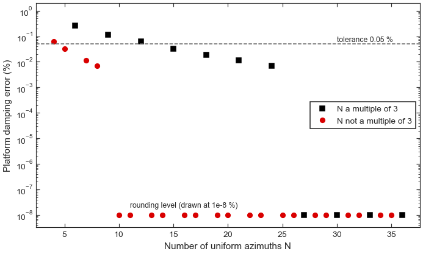

.. SPDX-License-Identifier: Apache-2.0

Tutorial 5: Azimuth averaging and its error
===========================================

**Goal:** choose how many azimuths a linearization needs, remove the rotor-azimuth
direction that makes coarse averages fail, and estimate the error of an azimuth
average branch by branch, with a check against the exact Floquet exponents.

**Script:** ``examples/05_azimuth_averaging.py`` · **Data:** a synthetic periodic
model · **Run time:** seconds

The model
---------

The MBC3 average of :doc:`mbc_eigenanalysis` removes the periodic content of the
transformed matrices only approximately. This tutorial uses a four-state model in
which that content is known exactly: a platform pitch rotation :math:`q`, the rotor
azimuth :math:`\psi` (the ElastoDyn generator-azimuth state ``DOF_GeAz``) and their
rates, at a rotor speed of 1 rad/s (9.55 rpm). Its matrix
:math:`\mathbf A(\psi)` (``periodic_rotor_matrix`` in ``examples/_synthetic.py``)
holds content at the blade-passing orders 3, 6, ..., 24, falling by a factor 0.6 per
order, which is what the MBC model of an isotropic three-bladed rotor carries. It is
built as the linearization about a periodic orbit: the time derivative of the orbit
solves the linear equations, so one Floquet exponent is exactly zero, as for a real
rotating turbine. The platform mode has a frequency of 0.048 Hz (0.299 rad/s) and a
damping ratio of 3.2 %. The model is small and exact, not a turbine: the numbers below
show the method, not the size of the errors to expect on a real linearization.

The code
--------

.. literalinclude:: ../../examples/05_azimuth_averaging.py
   :language: python
   :start-at: from vane
   :end-before: def main

.. literalinclude:: ../../examples/05_azimuth_averaging.py
   :language: python
   :pyobject: main

Run it
------

.. code-block:: console

   $ python examples/05_azimuth_averaging.py

.. code-block:: text

   Azimuth count N and its first alias order lcm(N, 3)
     N         3   4   5   6   7   8   9  10  11  12  13
     alias     3  12  15   6  21  24   9  30  33  12  39
   Smallest alias-free count for content up to order 18: 7; up to order 24: 10

   Azimuth state 1, rotor-speed state 3
   Reference eigenvalues: [-2.00628e-01+0.j       -9.60800e-03-0.299248j -9.60800e-03+0.299248j
    -1.56000e-04+0.j      ]
   Orbit tangent: [ 1.48e-03  1.00e+00 -0.00e+00 -1.60e-04]
   Mean of 9 uniform azimuths, eigenvalues
     delivered column: [-0.29523+0.j      -0.00727+0.j       0.04125-0.33833j  0.04125+0.33833j]
     pinned:           [-0.20054+0.j      -0.00965-0.30077j -0.00965+0.30077j -0.     +0.j     ]

   Uniform azimuth counts, platform damping error (resolved, worst start)
     N   alias  mult. of 3  damping err. (%)  frequency err. (%)
      4     12       False            0.0619                 0.6
      5     15       False            0.0323                0.32
      6      6        True             0.258                2.25
      7     21       False            0.0115               0.115
      8     24       False           0.00685              0.0691
      9      9        True             0.114                1.07
     10     30       False          7.14e-13            1.48e-13
     11     33       False          9.95e-13             1.3e-13
     12     12        True            0.0619                 0.6
     13     39       False          1.02e-12             1.3e-13
     14     42       False          9.95e-13            9.28e-14
     15     15        True            0.0323                0.32
     16     48       False          9.95e-13             1.3e-13
     17     51       False          6.49e-13            1.67e-13
     18     18        True            0.0192               0.192
   Recommended count (0.05 % damping): 5; resolved orders: up to 35

   Error estimate of a 36-azimuth linearization (percent of reference)
     samples    grid  status    sampling      quadrature  periodicity  accept
                                zeta     f    zeta        zeta
     delivered    18  measured     341   9.69      2.56       0.0195  False
     delivered     9  measured     585   18.4      2.56       0.0195  False
     pinned       18  measured  0.0695   0.17   0.00503     0.000258  False
     pinned        9  measured   0.405   1.02   0.00503     0.000258  False
   Azimuth assessment: consistent
   Platform eigenvalue of the 36-azimuth mean: -0.010346+0.298770j
   Platform eigenvalue of the 72-azimuth mean: -0.009608+0.299248j

   Platform branch of the 72-azimuth model (1/s)
     averaged eigenvalue:         -0.0096079+0.2992479j
     averaged + periodicity term: -0.0096090+0.2992057j
     Floquet exponent (monodromy): -0.0096090+0.2992040j

   Commensurate time step: 0.024933 s (7 steps per 10 deg)
   Figure written: tutorial_azimuth_count.png

         with multiples of three marked separately.
   :width: 100%

   Worst-case damping error of the platform mode for a uniform average of N azimuths
   (pinned model). A count that is a multiple of 3 (squares) is first disturbed by the
   harmonic of order N; any other count (circles) only by the harmonic of order 3N.

Step by step
------------

**1. The blade-number rule.** A uniform average of :math:`N` samples cancels every
harmonic except the multiples of :math:`N`. After the MBC3 transform an isotropic
:math:`B`-bladed rotor leaves content only at multiples of :math:`B`, so the first
order that survives the average is :math:`\operatorname{lcm}(N, B)`
(:func:`~vane.modal.averaging_error_estimate.first_alias_order`). For :math:`B = 3`,
12 azimuths are first disturbed by order 12, but 13 azimuths only by order 39. A count
that is not a multiple of the blade number is worth three times as many samples.
:func:`~vane.modal.averaging_error_estimate.alias_free_azimuth_count` inverts the rule:
7 azimuths clear content up to order 18, and 10 clear content up to order 24, the
highest order of this model.

**2. The reference.** 72 uniform azimuths resolve every order up to 35, so their
average is exact for this model. :func:`~vane.modal.averaging.locate_azimuth_state`
finds the azimuth position and rotor-speed states from their ``DOF_GeAz``
descriptions. The reference has the platform pair, a fast rotor-speed root, and an
azimuth eigenvalue of :math:`-1.6\times10^{-4}` 1/s that should be zero: the residue
of the averaging.

**3. Pinning the azimuth direction.** The azimuth column of :math:`\mathbf A(\psi)` is
large and rich in high harmonics, and with the rotor-speed state it forms a nearly
defective pair. A coarse average of it can be badly wrong: the 9-azimuth mean of the
delivered matrices makes the platform mode unstable (+0.041 1/s). The orbit tangent of
the dense mean, :func:`~vane.modal.averaging.azimuth_tangent`, is the direction along
the periodic orbit. :func:`~vane.modal.averaging.pin_azimuth` modifies every sample so
that this direction is an exact null vector. Every average of the pinned samples then
has an exact zero eigenvalue, and all the other eigenvalues of the reference are
unchanged. The pinned 9-azimuth mean gives the platform mode at
:math:`-0.00965 \pm 0.30077j`, close to the reference.

**4. The error of each azimuth count.**
:func:`~vane.modal.averaging_error_estimate.azimuth_count_table` evaluates the exact
eigenvalues of the uniform :math:`N`-mean of the fitted harmonic model, worst over 24
start azimuths, and reports the damping and frequency error of each branch. The
figure shows the rule at work: every count that is not a multiple of 3 from 10 up is
exact to rounding, because its first alias lies above order 24, while 12, 18 and 24
azimuths, the customary choices, still carry errors of up to 0.06 % in damping and
0.6 % in frequency. ``recommended_resolved`` is the smallest count whose first alias
the samples resolve and whose error meets the tolerance: 5 azimuths for 0.05 %.

**5. The error estimate of a real-looking linearization.** OpenFAST takes each
snapshot at the first time step at or past its target azimuth, so the delivered grid
is uneven. The script builds 36 azimuths, each delayed by up to 30 % of the spacing.
:func:`~vane.modal.averaging_error_estimate.estimate_averaging_error` reports three
terms per branch, in percent of the reference value:

* **sampling**: the error of a coarser grid. Sub-grids of the delivered samples (18
  and 9 azimuths here) are measured exactly; the column ``f`` is the frequency error;
* **quadrature**: the arithmetic mean that the MBC3 transform applies against the
  interval-weighted mean of the uneven grid;
* **periodicity**: the difference between the averaged eigenvalue and the Floquet
  exponent of the periodic model, from a second-order sideband estimate.

On the delivered samples the sampling errors are enormous (341 % and 585 % in damping)
and the quadrature error is 2.6 %: both come from the azimuth column. After pinning
they fall to 0.07 % and 0.4 % (sampling) and 0.005 % (quadrature). The branch is still
not accepted (``accept`` is ``False``): with the default tolerances of 1 % in damping
and 0.1 % in frequency, the frequency errors of 0.17 % and 1.0 % are too large.
``Azimuth assessment: consistent`` means that the azimuth residual cannot move the
platform damping beyond the tolerance.

The last two lines show what no single grid can measure about itself: the uneven
36-azimuth mean puts the platform damping at :math:`0.010346/0.2985 = 3.46\,\%`, the
dense mean at 3.21 %, a 7.7 % difference. The estimate assesses sub-grids and
hypothetical grids against the samples you have; it cannot bound the error of the full
delivered grid, which is why the commensurate time step of step 7 matters.

**6. The check against Floquet theory.** On the dense uniform grid the periodicity term
moves the averaged platform eigenvalue from :math:`-0.0096079 + 0.2992479j` to
:math:`-0.0096090 + 0.2992057j`. The Floquet exponent computed independently from the
monodromy matrix over one revolution, :func:`~vane.modal.floquet.monodromy_exponents`
with 720 azimuths, is :math:`-0.0096090 + 0.2992040j`. The sideband estimate recovers
the difference between the average and the periodic system to within
:math:`2\times10^{-6}` 1/s.

**7. A commensurate time step.**
:func:`~vane.modal.averaging_error_estimate.commensurate_time_step` suggests a time
step no larger than the one requested (0.025 s) that places every target azimuth on a
whole number of steps: 0.024933 s, seven steps per 10 degrees. With it, and the rotor
at its trimmed speed, the delivered grid is uniform, the quadrature term vanishes and
the uneven-grid error of step 5 does not arise.

Exercises
---------

1. In ``sample``, pass ``decay=0.3`` to ``periodic_rotor_matrix`` and rerun. The
   high harmonics are now smaller, so the errors of the multiples of 3 fall faster
   with N.
2. Pass ``grid=13`` to ``estimate_averaging_error``: a hypothetical 13-azimuth grid
   has its first alias at order 39, above the 17 orders 36 azimuths resolve, so the
   status reads ``unresolved`` and the branch is not accepted. A denser reference is
   needed to confirm such a count.

See :doc:`../user_guide/azimuth_averaging` for every option and :doc:`../theory/floquet`
for the periodic theory. Next: :doc:`state_space_export`.
