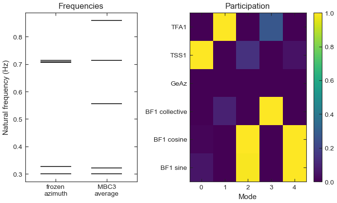

.. SPDX-License-Identifier: Apache-2.0

Tutorial 2: MBC3 transform and eigenanalysis
============================================

**Goal:** read the ``.lin`` files of one operating point, transform the rotating blade
states into the fixed frame and average over azimuth with
:func:`~vane.io.mbc_transform.mbc3_transform`, then find the natural frequencies,
damping ratios and participation of the modes with
:func:`~vane.modal.eigensolver.modes_from_mbc`.

**Script:** ``examples/02_mbc_and_eigenanalysis.py`` · **Data:** one synthetic
operating point (see :ref:`tutorial-synthetic-turbine`) · **Run time:** seconds

The code
--------

.. literalinclude:: ../../examples/02_mbc_and_eigenanalysis.py
   :language: python
   :start-at: from vane
   :end-before: def short_name

.. literalinclude:: ../../examples/02_mbc_and_eigenanalysis.py
   :language: python
   :pyobject: main

``short_name`` (in the script) only turns a description such as
``"ED 1st tower fore-aft bending mode DOF (internal DOF index = DOF_TFA1), m"`` into
``TFA1`` for the printed tables.

Run it
------

.. code-block:: console

   $ python examples/02_mbc_and_eigenanalysis.py

.. code-block:: text

   Read 12 files, ws080.1.lin to ws080.12.lin
     12 states, 2 inputs, 8 outputs; rotor speed 0.9587 rad/s, wind 8.0 m/s
     6 states in the rotating frame, e.g. 'ED 1st flapwise bending-mode DOF of blade 1 (internal DOF index = DOF_BF(1,1)), m'

   MBC3 transform
     performed: True, blades: 3
     rotor speed 9.155 rpm, wind 8.0 m/s
     azimuths (deg): [0.0, 30.0, 60.0, 90.0, 120.0, 150.0, 180.0, 210.0, 240.0, 270.0, 300.0, 330.0]
     ndof2 = 6, ndof1 = 0
     displacement states: ['TFA1', 'TSS1', 'GeAz', 'BF1 collective', 'BF1 cosine', 'BF1 sine']

   Eigenanalysis: 5 oscillatory modes, 1 rigid-body DOF, 1 real eigenvalues
     mode   f_n (Hz)   f_d (Hz)   damping (-)
        0     0.3000     0.3000       0.0097
        1     0.3215     0.3210       0.0589
        2     0.5564     0.5508       0.1415
        3     0.7133     0.7091       0.1089
        4     0.8590     0.8554       0.0921

   Participation (each column scaled to a maximum of 1)
     DOF              mode 0  mode 1  mode 2  mode 3  mode 4
     TFA1             0.000   1.000   0.000   0.270   0.000
     TSS1             1.000   0.000   0.143   0.000   0.050
     GeAz             0.000   0.000   0.000   0.000   0.000
     BF1 collective   0.000   0.090   0.000   1.000   0.000
     BF1 cosine       0.014   0.000   1.000   0.000   0.998
     BF1 sine         0.058   0.000   0.992   0.000   1.000

   Azimuth spread of the natural frequency (Hz)
     4.78e-14, 3.64e-03, 1.49e-14, 3.45e-05, 5.75e-15

   Frozen azimuth (0 deg), mixed frame, no MBC
     f_n (Hz): 0.3002, 0.3266, 0.7069, 0.7080, 0.7134
   Figure written: tutorial_mbc_modes.png

         average. Right, the participation of each degree of freedom in each mode.
   :width: 100%

   Left: the frozen-azimuth matrix has three blade frequencies near 0.71 Hz; the MBC3
   average splits them into 0.556, 0.713 and 0.859 Hz. Right: the participation of
   each degree of freedom in each of the five modes.

Step by step
------------

**1. One operating point is a set of files.** OpenFAST writes one ``.lin`` file per
linearization time, named ``<case>.<n>.lin``. A ``CalcSteady`` linearization with
``NLinTimes = 12`` writes twelve snapshots spread over one rotor revolution, and
together they describe one operating point. The synthetic turbine writes the same
twelve files at 8 m/s and 9.155 rpm.

**2. Reading.** :func:`~vane.io.lin_reader.read_lin_file` returns a
:class:`~vane.io.lin_reader.LinFile` with the header values (``rotor_speed`` in rad/s,
``azimuth`` in rad, ``wind_speed``), the operating-point tables ``x``, ``u`` and ``y``
with their descriptions and rotating-frame flags, and the matrices ``a`` to ``d``. The
six blade states carry the flag ``T``: OpenFAST writes them in each blade's rotating
frame.

**3. The MBC3 transform.** :func:`~vane.io.mbc_transform.mbc3_transform` groups the
rotating states into blade triplets by their descriptions (blade 1, 2 and 3 of the
same degree of freedom), replaces each triplet by its collective, cosine and sine
coordinates, transforms the matrices of every azimuth into the fixed frame, and
averages them. It also reorders the states into the ``[q2, q2dot, q1]`` layout: here
six displacements, their six rates and no first-order states (``ndof2 = 6``,
``ndof1 = 0``). The descriptions of the three transformed flap states still name blades
1, 2 and 3; ``mbc.mbc_coordinates`` says which is the collective, cosine and sine
coordinate. ``retain_per_azimuth=True`` keeps the transformed matrix of each azimuth,
which step 6 needs.

**4. The eigenanalysis.** :func:`~vane.modal.eigensolver.modes_from_mbc` solves the
eigenvalue problem of the averaged matrix and keeps one eigenvalue per complex
conjugate pair, sorted by frequency. Two degrees of freedom have no oscillatory mode:
the generator azimuth has a zero eigenvalue (counted as a rigid-body degree of
freedom), and the rotor speed decays without oscillating (one real eigenvalue,
``n_overdamped``). Five modes remain: tower side-side at 0.300 Hz, tower fore-aft at
0.3215 Hz, and three flap modes at 0.556, 0.713 and 0.859 Hz.

Check the flap modes by hand. In the rotating frame each blade's flap frequency is
:math:`f_r=\sqrt{0.68^2+1.6\,f_\Omega^2}`, with the rotor frequency
:math:`f_\Omega = 9.155/60 = 0.1526` Hz, so :math:`f_r = 0.7069` Hz. Seen from the
fixed frame, a backward-whirling (regressive) flap motion appears at
:math:`f_r - f_\Omega = 0.554` Hz and a forward-whirling (progressive) one at
:math:`f_r + f_\Omega = 0.860` Hz, while the collective mode stays near :math:`f_r`.
The computed 0.556, 0.713 and 0.859 Hz differ from these estimates only by the
coupling to the tower.

**5. Participation.** :func:`~vane.modal.participation.participation_from_modes`
measures how strongly each degree of freedom takes part in each mode, from the
magnitudes of the mode shape, with each column scaled to a maximum of 1. The tower
modes are almost pure. The collective flap mode carries 27 % tower fore-aft motion,
because the three blades push the tower top together. The regressive and progressive
modes have equal cosine and sine parts: a whirl, with a small side-side component from
the side-side coupling. All the translations here are in metres, so the magnitudes are
comparable. In a real linearization the degrees of freedom have different units;
:func:`~vane.modal.participation.participation_scale_factors` corrects for that, and
the labels of :doc:`mode_identification_campbell` use a participation measure that does
not depend on units at all.

**6. Azimuth spread.** :func:`~vane.modal.uncertainty.azimuth_spread` estimates, per
mode, how much the frequency changes between the transformed matrices of the twelve
azimuths. Only the tower fore-aft mode has a spread worth noting (3.6 mHz): it comes
from the 3P term in its stiffness, which the average removes. The blade modes have no
spread because the synthetic rotor is isotropic, and the collective mode inherits a
small spread from its coupling to the tower.

**7. Why the transform is needed.** :func:`~vane.modal.eigensolver.compute_modes`
solves the eigenvalue problem of any state matrix. Applied to the frozen matrix of the
first file, in OpenFAST's mixed frame, it finds three blade frequencies between 0.707
and 0.713 Hz: the rotating-frame frequency, with no regressive or progressive split.
That model is neither the fixed-frame dynamics nor time invariant, which is why the
analysis starts from the MBC3 average.

Exercises
---------

1. Change ``N_AZIMUTHS`` to 3 and run again. The tower fore-aft mode moves from
   0.3215 to 0.3266 Hz: three azimuths 120 degrees apart see the 3P stiffness term at
   the same phase, so the average keeps it instead of removing it. With 4 azimuths the
   mode is back at 0.3215 Hz, because a 4-azimuth average is first disturbed by order
   12. :doc:`azimuth_averaging` turns this into a rule for choosing the count.
2. Replace the synthetic files with the ``.lin`` files of one point from
   :doc:`linearization_sweep` and add ElastoDyn's blade and tower lengths through
   :func:`~vane.modal.participation.participation_scale_factors`.

See :doc:`../user_guide/mode_identification` for the options of each step and
:doc:`../theory/linearization_mbc` for the transform itself.
Next: :doc:`mode_identification_campbell`.
