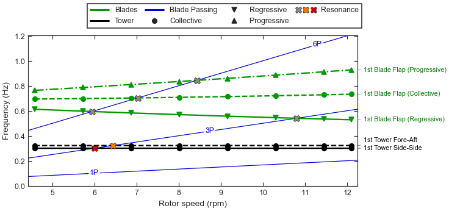

.. SPDX-License-Identifier: Apache-2.0

Tutorial 3: Mode identification and the Campbell diagram
========================================================

**Goal:** label the modes of an operating point by their physics, track them across a
sweep with :class:`~vane.ModalPipeline`, find where they cross the per-revolution
excitation lines, export the Campbell diagram as tables, and draw it.

**Script:** ``examples/03_mode_identification_campbell.py`` · **Data:** a synthetic
sweep of ten operating points, 4 to 15 m/s (see :ref:`tutorial-synthetic-turbine`) ·
**Run time:** seconds

The code
--------

.. literalinclude:: ../../examples/03_mode_identification_campbell.py
   :language: python
   :start-at: from vane
   :end-before: def main

.. literalinclude:: ../../examples/03_mode_identification_campbell.py
   :language: python
   :pyobject: main

Run it
------

.. code-block:: console

   $ python examples/03_mode_identification_campbell.py

.. code-block:: text

   Discovered 10 operating points:
     ws040: 12 azimuths, wind  4.0 m/s, rotor  4.578 rpm
     ws050: 12 azimuths, wind  5.0 m/s, rotor  5.722 rpm
     ws060: 12 azimuths, wind  6.0 m/s, rotor  6.866 rpm
     ws070: 12 azimuths, wind  7.0 m/s, rotor  8.011 rpm
     ws080: 12 azimuths, wind  8.0 m/s, rotor  9.155 rpm
     ws090: 12 azimuths, wind  9.0 m/s, rotor 10.300 rpm
     ws100: 12 azimuths, wind 10.0 m/s, rotor 11.444 rpm
     ws110: 12 azimuths, wind 11.0 m/s, rotor 12.100 rpm
     ws130: 12 azimuths, wind 13.0 m/s, rotor 12.100 rpm
     ws150: 12 azimuths, wind 15.0 m/s, rotor 12.100 rpm

   Labels at 8 m/s
     f_n (Hz)  label                          category             conf.
       0.3000  1st Tower Side-Side            TOWER_SIDE_SIDE_1     0.99
       0.3215  1st Tower Fore-Aft             TOWER_FORE_AFT_1      0.98
       0.5564  1st Blade Flap (Regressive)    BLADE_FLAP_1          0.99
       0.7133  1st Blade Flap (Collective)    BLADE_FLAP_1          0.98
       0.8590  1st Blade Flap (Progressive)   BLADE_FLAP_1          1.00

   Campbell diagram: 5 tracks over 8 points
     track  label                          f(first)  f(last)  conf.  ambig.
         0  1st Tower Side-Side              0.3001   0.2999   1.00  False
         1  1st Tower Fore-Aft               0.3213   0.3217   1.00  False
         2  1st Blade Flap (Regressive)      0.6117   0.5278   1.00  False
         3  1st Blade Flap (Collective)      0.6936   0.7324   1.00  False
         4  1st Blade Flap (Progressive)     0.7633   0.9270   1.00  False

   Resonance crossings
     track  harmonic  rotor (rpm)  f (Hz)  damping  severity
         0        3P         6.00   0.300   0.0093  high
         1        3P         6.43   0.321   0.0488  medium
         2        3P        10.80   0.540   0.1555  low
         2        6P         5.94   0.594   0.1169  low
         3        6P         7.03   0.703   0.1015  low
         4        6P         8.43   0.843   0.0912  low

   Campbell table: 40 rows, columns ['track', 'label', 'multiblade', 'rotor_speed_rpm', 'natural_frequency_hz', 'damping_ratio', 'confidence', 'is_ambiguous']
   Tables written: campbell.csv, resonances.csv, campbell.xlsx
   Figure written: tutorial_campbell.png

   Rotor-speed axis over the full sweep raises ValueError:
     operating points must have distinct 'rotor_speed_rpm' values; got duplicates
     (12.099913703504432) in [4.577932783095278, 5.72193851403982, 6.865944244984365,
     8.010904905587461, 9.154910636532005, 10.2998712971351, 11.44387702807964,
     12.099913703504432, 12.099913703504432, 12.099913703504432]; use the wind-speed axis
     instead: parameter_name='wind_speed' (CLI: --parameter wind), which is distinct
     across these operating points
   Wind-speed axis: 5 tracks over 10 points, 0 resonances reported

         3P and 6P lines and the resonance crossings marked by crosses.
   :width: 100%

   The five tracks against rotor speed, grouped by mode family, the 1P, 3P and 6P
   excitation lines (dashed, from the bottom), and the crossings coloured by severity.
   The flap triplet fans out with rotor speed; the tower modes cross 3P near 6 rpm and
   the regressive flap mode near 10.8 rpm.

Step by step
------------

**1. Discovering operating points.** :func:`~vane.discover_operating_points` groups
the files of a directory by their ``<case>`` root, so ``ws080.1.lin`` to
``ws080.12.lin`` form the operating point ``ws080``. Each returned point is a sequence
of :class:`~vane.io.lin_reader.LinFile` objects, ready for every function that takes
the files of one point. The sweep has eight points below rated, where the rotor speed
rises with the wind, and two above it at the rated 12.1 rpm.

**2. Physical labels.** :func:`~vane.modal.labeler.label_solution` names each mode of
one operating point from the share of its participation carried by each kind of degree
of freedom, using left and right eigenvectors so the result does not depend on the
units of the states. The ``category`` is the winning
:class:`~vane.config.dof_map.DofCategory`; ``confidence`` is its share (0.98 to 1.00
here, since the synthetic modes are nearly pure). For the flap triplet the
multi-blade coordinates decide the type: equal cosine and sine parts whirling backward
make the regressive mode, forward the progressive one, and the collective coordinate
the collective mode.

**3. Tracking and the Campbell diagram.** :meth:`ModalPipeline.run
<vane.pipeline.ModalPipeline.run>` runs the MBC3 transform and the eigenanalysis of
:doc:`mbc_eigenanalysis` at every point, labels the modes, and links them from point to
point by their mode-shape correlation (MAC) and frequency continuity. Each
:class:`~vane.modal.identifier.ModeTrack` is one line of the diagram; its
``confidence`` is the weakest link along the track and ``is_ambiguous`` flags a near
tie. Here every link is unambiguous. The regressive mode falls from 0.612 to 0.528 Hz
and the progressive mode rises from 0.763 to 0.927 Hz as the rotor speeds up: the
:math:`\mp\Omega` split of :doc:`mbc_eigenanalysis` growing with :math:`\Omega`.

The points are tracked on the rotor-speed axis, the default
(``parameter_name="rotor_speed_rpm"``), because the resonance search needs it. The
script passes only the points up to 11 m/s, whose rotor speeds are all different.

**4. Resonance crossings.** A rotor turning at ``rpm`` excites the structure at
``n * rpm / 60`` Hz. ``ModalPipeline(harmonics=(1, 3, 6))`` searches the 1P, 3P and 6P
lines (the default is ``(1, 3, 6, 9)``), and ``result.resonances`` lists each crossing,
interpolated between operating points. Check the first by hand: the side-side mode at
0.300 Hz meets 3P where ``3 * rpm / 60 = 0.300``, at 6.00 rpm. The severity follows
the damping ratio at the crossing: below 0.01 is ``high`` (the side-side mode, with
almost no aerodynamic damping), 0.01 to 0.05 ``medium`` (the fore-aft mode) and above
``low`` (the aerodynamically damped flap modes). No mode crosses 1P, which stays below
0.21 Hz.

**5. Tables.** :func:`~vane.export.campbell_table` flattens the diagram into a
:class:`pandas.DataFrame` with one row per track and operating point (5 tracks x 8
points = 40 rows), and :func:`~vane.export.resonance_table` does the same for the
crossings. :func:`~vane.export.write_table` chooses the format from the suffix:
``.csv``, ``.json``, ``.mat``, or ``.xlsx`` when ``openpyxl`` is installed (the
``excel`` extra). The script writes the Excel file only when ``openpyxl`` is
available.

**6. Plots.** :func:`~vane.viz.campbell_plot.plot_campbell` returns an interactive
Plotly figure with the damping ratio and confidence of each point on hover; the script
saves it as ``campbell.html``. :func:`~vane.viz.campbell_plot.plot_campbell_static`
draws the same diagram with Matplotlib for reports, as in the figure above: the tracks
styled by mode family, the excitation lines of the chosen harmonics and the crossings.
For a diagram of your own, :meth:`~vane.campbell.builder.CampbellDiagram.track_curve`
gives each track's parameter values, frequencies and damping ratios, and
:func:`~vane.campbell.excitation.excitation_frequencies` the excitation lines.

**7. Past rated, use the wind-speed axis.** Above rated the trimmed rotor speed is
constant, so three points share 12.1 rpm and cannot be ordered by it. The pipeline
rejects that axis with the ``ValueError`` shown, rather than tracking modes between
points in an arbitrary order, and names the remedy. On the wind-speed axis
(``parameter_name="wind_speed"``) all ten points are tracked. No crossings are reported
there, because the excitation lines are defined in rotor speed.

Exercises
---------

1. Open ``campbell.html`` (run with ``--output``) and hover over a track to see its
   damping ratio and label confidence at each point.
2. Change ``HARMONICS`` to ``(1, 3, 6, 9)``. The 9P line crosses the collective and
   progressive flap modes at low rotor speed; check the first crossing by hand.
3. Pass ``ModalPipeline(branch_review=True)`` and confirm that
   ``result.identification.branch_groups`` is empty: no two tracks of this turbine
   approach each other closely enough to be contested.

See :doc:`../user_guide/mode_identification` and :doc:`../user_guide/campbell_diagrams`
for the options, and :doc:`../theory/modal_identification` and
:doc:`../theory/campbell_uncertainty` for the methods.
Next: :doc:`mode_shapes`.
