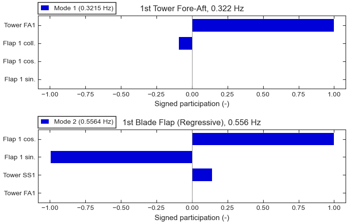

.. SPDX-License-Identifier: Apache-2.0

Tutorial 4: Mode shapes
=======================

**Goal:** look at what each mode does, three ways: a static chart of the participating
degrees of freedom, an interactive 3-D view of the deformed turbine, and an animation
for VTK viewers.

**Script:** ``examples/04_mode_shapes.py`` · **Data:** one synthetic operating point
at 8 m/s (see :ref:`tutorial-synthetic-turbine`) · **Run time:** seconds

The code
--------

.. literalinclude:: ../../examples/04_mode_shapes.py
   :language: python
   :start-at: from vane
   :end-before: def main

.. literalinclude:: ../../examples/04_mode_shapes.py
   :language: python
   :pyobject: main

Run it
------

.. code-block:: console

   $ python examples/04_mode_shapes.py --output shapes

.. code-block:: text

   mode 0: 0.3000 Hz  1st Tower Side-Side
   mode 1: 0.3215 Hz  1st Tower Fore-Aft
   mode 2: 0.5564 Hz  1st Blade Flap (Regressive)
   mode 3: 0.7133 Hz  1st Blade Flap (Collective)
   mode 4: 0.8590 Hz  1st Blade Flap (Progressive)
   Figure written: tutorial_mode_participation.png
   3-D views written: mode_1_*.html, mode_2_*.html
   VTK animation: regressive_flap.pvd and 24 frames, 89 nodes on 7 members

         fore-aft mode and in the regressive flap mode.
   :width: 100%

   Signed participation of the four most active degrees of freedom in the tower
   fore-aft mode (top) and the regressive flap mode (bottom).

Step by step
------------

**1. The modes.** The script repeats the analysis of :doc:`mbc_eigenanalysis` and the
labels of :doc:`mode_identification_campbell` at 8 m/s, and picks the tower fore-aft
and the regressive flap modes by their labels.

**2. Participation charts.** :func:`~vane.viz.modeshape_static.plot_mode_participation`
draws the most active degrees of freedom of one mode as bars, signed by their phase
relative to the dominant one: a negative bar moves in opposition. The tower fore-aft
mode is almost pure tower motion, with the collective flap moving against it at a tenth
of its amplitude. In the regressive mode the cosine and sine flap coordinates have equal
size and a phase difference: the rotor disc wobbles, which in the fixed frame is the
backward whirl. With ``short_names=True`` the chart labels each bar with a short
degree-of-freedom name and, after the MBC3 transform, its multi-blade coordinate:
the three blade rows are the collective, cosine and sine coordinates, not blades 1, 2
and 3. The figure is drawn inside :func:`vane.viz.plot_style`, the plotting style of
VANE's static figures.

**3. Interactive views.** :func:`~vane.viz.modeshape_fowt.plot_mode_fowt` deforms a
schematic bottom-fixed turbine by the mode shape and returns a
Plotly figure; :func:`~vane.viz.modeshape_3d.plot_mode_3d` draws the complex mode
shape as phasors. The script writes both as HTML files to open in a browser. The
geometry is inferred from the degrees of freedom of the solution (a bottom-fixed
turbine here, since there are no platform states); pass a
:class:`~vane.config.system_config.FowtGeometry` for the dimensions of a specific
turbine.

**4. A VTK animation.** :func:`~vane.viz.modeshape_fowt.deform_mode` returns the
same deformation as complex nodal displacements on each member of the geometry. The
script stacks the members into one point set, with one polyline per member, and
:func:`~vane.viz.vtk_export.write_mode_animation_vtk` writes 24 frames over one period
of the oscillation as legacy VTK files, tied together by ``regressive_flap.pvd``. Open
the ``.pvd`` file in a VTK viewer and press play to see the rotor disc whirl. For a single
frozen shape, use :func:`~vane.viz.vtk_export.write_mode_shape_vtk`.

Exercises
---------

1. Plot the collective flap mode (``mode 3``) and compare it with the regressive one:
   the three blades now move in phase, and the tower fore-aft motion appears.
2. Call ``plot_mode_fowt(solution, k, phase_deg=90.0)`` to freeze the regressive mode
   a quarter period later, and see the deformation move from the cosine to the sine
   pattern.

See :doc:`../user_guide/visualization` for every plotting function and its options.
Next: :doc:`azimuth_averaging`.
