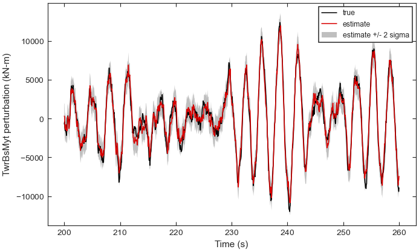

.. SPDX-License-Identifier: Apache-2.0

Tutorial 6: State-space, Kalman and LPV export
==============================================

**Goal:** turn the linearizations of a sweep into the models an estimator or a
controller needs: the state-space model of one operating point, a reduced model of its
structural modes, a Kalman filter that reconstructs a load from two accelerometers,
a mode-tracked family scheduled on wind speed, and a family of named physical states.

**Script:** ``examples/06_state_space_export.py`` · **Data:** a synthetic sweep of ten
operating points, 4 to 15 m/s (see :ref:`tutorial-synthetic-turbine`) ·
**Run time:** seconds

The code
--------

.. literalinclude:: ../../examples/06_state_space_export.py
   :language: python
   :start-at: from vane
   :end-before: def main

.. literalinclude:: ../../examples/06_state_space_export.py
   :language: python
   :pyobject: main

Run it
------

.. code-block:: console

   $ python examples/06_state_space_export.py --output export

.. code-block:: text

   State space at 8.0 m/s: 12 states, 2 inputs, 8 outputs, stable: False
     inputs:  ['IfW Extended input: horizontal wind speed (steady/uniform wind) (hub), m/s', 'ED Extended input: collective blade-pitch command, rad']
     outputs: ['ED YawBrTAxp, (m/s^2)', 'ED YawBrTAyp, (m/s^2)', 'ED GenSpeed, (rpm)', 'ED TwrBsMyt, (kN-m)', 'ED TwrBsMxt, (kN-m)', 'ED RootMyc1, (kN-m)', 'ED RootMyc2, (kN-m)', 'ED RootMyc3, (kN-m)']

   Modal reduction: 12 -> 8 states, energy retained 1.0000
     0.3215 Hz, damping 0.0589
     0.7133 Hz, damping 0.1089
     0.3000 Hz, damping 0.0097
     0.5564 Hz, damping 0.1415
     written: ['manifest.json', 'modes.csv', 'state_space.mat']

   Kalman filter on ['ED YawBrTAxp, (m/s^2)', 'ED YawBrTAyp, (m/s^2)'], dt = 0.05 s, 6000 steps
     mean NIS 1.998 (expected 2.0), consistent: True
     TwrBsMyt: true std 4422.2 kN-m, RMSE 799.9 kN-m, within 2 sigma 95.9 %

   Mode-tracked family: frequency (Hz) of each mode
     wind     mode 0  mode 1  mode 2  mode 3
       4.0    0.3213  0.6936  0.3001  0.6117
       5.0    0.3213  0.6973  0.3001  0.5966
       6.0    0.3214  0.7019  0.3001  0.5824
       7.0    0.3215  0.7072  0.3000  0.5690
       8.0    0.3215  0.7133  0.3000  0.5564
       9.0    0.3216  0.7202  0.2999  0.5447
      10.0    0.3217  0.7278  0.2999  0.5337
      11.0    0.3217  0.7324  0.2999  0.5278
      13.0    0.3217  0.7324  0.2999  0.5280
      15.0    0.3218  0.7324  0.2999  0.5283
     lowest tracking MAC per mode: [1.     1.     1.     0.9999]
   Scheduled at 9.5 m/s: 8 states, min tracking MAC 1.0000, extrapolated False
   Saved and reloaded family.npz: matrices identical True

   Tower and generator only raises ValueError:
     the state selection drops 0.471 relative coupling at WindSpeed = 11 m/s (A: 0.471,
     C: 0.0027), above max_dropped_coupling=0.05; the largest contributing dropped states
     are 'ED 1st flapwise bending-mode DOF of blade 1 (internal DOF index = DOF_BF(1,1))'
     (0.272), 'ED 1st flapwise bending-mode [...]
   Physical family: 10 points, 10 states, scheduled on WindSpeed (m/s)
     twins added: 5
     dropped coupling: max 1.56e-18
     saved and reloaded physical_family.npz: matrices identical True
   Figure written: tutorial_kalman_load.png

         estimate and its two-standard-deviation band.
   :width: 100%

   The tower-base fore-aft moment reconstructed from two tower-top accelerometers:
   the simulated truth, the filter estimate, and the estimate's two-standard-deviation
   band, over 60 s of the 300 s record.

Step by step
------------

**1. The sweep.** The script writes the ten operating points and runs
:class:`~vane.ModalPipeline` on the wind-speed axis, because the rotor speed is constant
above rated (see :doc:`mode_identification_campbell`).

**2. The full-order model.** :meth:`~vane.pipeline.PipelineResult.state_space` returns
the azimuth-averaged model of one operating point as a
:class:`~vane.sysid.state_space.StateSpace`, with the ``.lin`` names of its states,
inputs and outputs. The three blade-root moments are in multi-blade coordinates
(collective, cosine, sine), as recorded in ``system.output_mbc_coordinates``. The model
is not asymptotically stable (``stable: False``) because the generator-azimuth state
has a zero eigenvalue: the rotor position is free. A filter should not run on such a
model, which is the reason for the next step.

**3. Modal reduction.** :func:`~vane.sysid.rom.modal_reduction` keeps the underdamped
modes in the band 0.1 to 2 Hz with the largest residue in the tower-base fore-aft
moment ``TwrBsMyt``, as a real block-diagonal model with two states per mode and the
original inputs and outputs. Four modes are kept: the two tower modes and the
regressive and collective flap modes; the progressive mode, which drives the tower
base least, is left out. The azimuth and rotor-speed states are gone.
:func:`~vane.export.write_rom` writes the matrices (``state_space.mat``), a table of
the retained modes (``modes.csv``) and a manifest with the VANE version.

**4. A Kalman filter.** The sensors are the two tower-top accelerometers,
``YawBrTAxp`` and ``YawBrTAyp``. The script keeps their rows of the reduced model,
builds the continuous process noise of each mode with
:func:`~vane.sysid.process_noise.modal_process_noise`, discretizes it exactly over the
0.05 s step with :func:`~vane.sysid.process_noise.discretize_process_noise`, takes the
sensor noise (0.02 m/s²) with
:func:`~vane.sysid.process_noise.measurement_noise_from_specs`, and assembles the
discrete filter model with :func:`~vane.sysid.kalman_interface.build_kalman_model`.
A 300 s record is then simulated from the same model, with process and sensor noise.
:func:`~vane.sysid.kalman_filter.run_filter` runs the filter over it (the inputs are
zero perturbations, passed explicitly because the accelerometers have a feedthrough
term). :func:`~vane.sysid.kalman_filter.filter_consistency` tests the normalized
innovation squared: its mean of 1.998 against the expected 2.0 (two sensors) shows the
filter is tuned to the noise it sees.
:func:`~vane.sysid.kalman_filter.reconstruct_load` reconstructs ``TwrBsMyt``, which no
sensor measures, from the filter state, with its standard deviation. The error is 800
kN-m against a load of 4422 kN-m standard deviation, and 95.9 % of the errors lie
within two standard deviations, close to the 95.4 % expected of a Gaussian error.
Because the truth comes from the filter's own model, this is a check of the
implementation, not of the accuracy to expect on a real turbine.

**5. A mode-tracked family.** :func:`~vane.sysid.rom_family.build_rom_family` reduces
every operating point to the same four modes, matched by their output residues, in the
same state order and phase, so that neighbouring members can be blended. The tracking
MAC of every mode is 1.0 (0.9999 for the regressive mode). The flap frequencies change
with rotor speed up to 11 m/s and stay constant above rated. Mode 3 is the regressive
mode, whose frequency falls from 0.612 to 0.528 Hz.
:func:`~vane.sysid.lpv.schedule_model` interpolates the family at 9.5 m/s between its
9 and 10 m/s members; ``min_tracking_mac`` and ``extrapolated`` tell whether the blend
can be trusted. :func:`~vane.sysid.serialize.save_rom_family` stores the family in a
``.npz`` file that :func:`~vane.sysid.serialize.load_rom_family` reads back with
``allow_pickle=False``.

**6. A physical-state family.** A controller usually needs named states rather than
modal ones. :func:`vane.export.build_physical_lpv_family` reads the ``.lin`` directory,
averages each operating point's azimuth files without the MBC3 transform, and selects
the named states, inputs and outputs by substring. Selecting only the tower fore-aft
and generator states is refused: the flap states that are left out carry 47 % of the
coupling into the selected rows, far above the default ceiling of 5 %
(``max_dropped_coupling=0.05``), and the error names the states responsible. Adding the
three flap states makes the selection complete: the side-side tower state, still left
out, couples to the blades through the sine of their azimuth, which averages to zero
over the twelve azimuths, so the dropped coupling falls to rounding (1.6e-18).
``pair_derivatives`` adds the rate twin of each requested displacement, so the five
requested states become ten. :func:`~vane.sysid.serialize.save_lpv_family` stores the
:class:`~vane.sysid.physical_lpv.LPVFamily` in a ``.npz`` file, with its channel names,
scheduling variable and unit, and the schema version of the archive;
:func:`~vane.sysid.serialize.load_lpv_family` reads it back with ``allow_pickle=False``.

Exercises
---------

1. Rank the reduction by the blade-root moment instead (``rank_output="RootMyc1"``,
   the collective coordinate after the transform). The collective flap mode now comes
   first, and the progressive mode replaces the regressive one.
2. Lower ``SENSOR_STD`` to 0.005 m/s². The filter stays consistent and the error of
   the reconstructed moment falls from 800 to 635 kN-m: the process noise, not the
   sensors, now limits the estimate.

See :doc:`../user_guide/state_space_export` for the options of every step, and
:doc:`../theory/reduction_observability` and :doc:`../theory/lpv_estimation` for the
methods.
