.. SPDX-License-Identifier: Apache-2.0

Plot gallery
============

This page shows each static plot of :mod:`vane.viz` at the two printed sizes, one journal
column (``size="single"``, 8.5 cm wide) and the full page width (``size="double"``,
17 cm). The figures follow the style and encoding described in :doc:`visualization`:
the lab's standard line colours, mode families by colour (blades green, tower black,
platform red, drivetrain magenta, other modes cyan), line styles cycling within a
family, multi-blade types by marker, and blue ``nP`` lines tagged inline.

The images are generated from synthetic data by the script ``docs/gallery/make_gallery.py``
in the source repository, which writes a sweep of the synthetic turbine of the tutorials
(tower, rotor and blade-flap modes, 4 to 11 m/s) and analyses it with
:func:`~vane.study.run_study`. They are shown here as PNG files at 150 dpi; for a paper,
write the same figures as vector PDF or SVG with :func:`~vane.viz.save_figure`. Each
section gives the call that draws the figure.

.. contents:: Plots
   :local:
   :depth: 1

Campbell diagram
----------------

The frequencies of the tracked modes against rotor speed, with the 1P, 3P and 6P lines
and the resonance crossings. Each mode is named at its line end; in the single-column
figure the names are shortened.

.. code-block:: python

   plot_campbell_static(diagram, harmonics=(1, 3, 6), size="single")

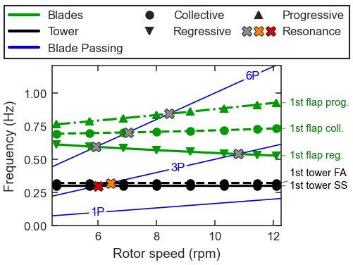

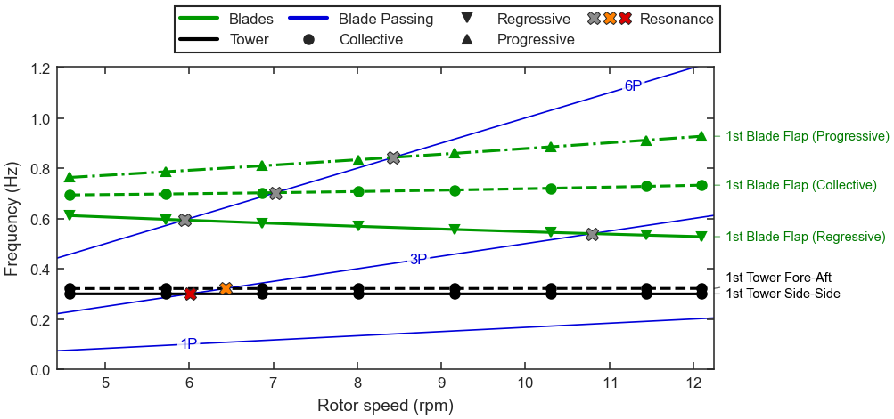

Campbell diagram with every mode family
---------------------------------------

A hand-built floating-turbine diagram that uses every family, a low-confidence track
(faded), an ambiguous track (open diamonds) and a shaded operating window.

.. code-block:: python

   plot_campbell_static(
       diagram, harmonics=(1, 3, 6), operating_range=(6.9, 12.1), size="double"
   )

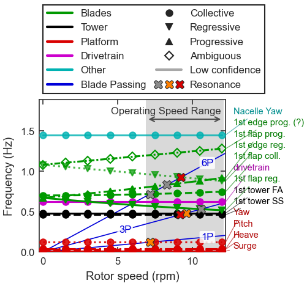

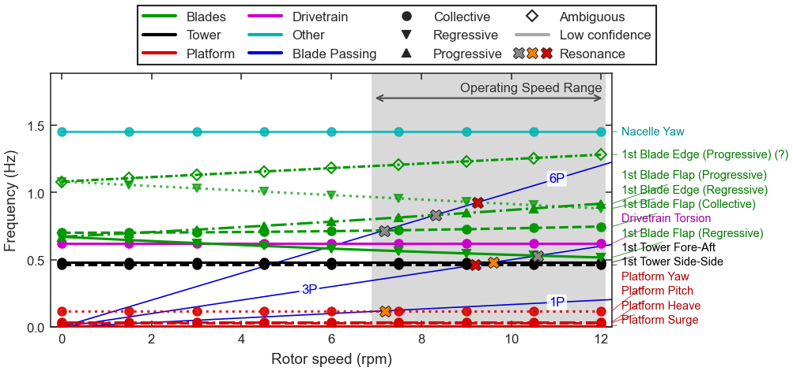

Damping ratio
-------------

The damping ratio of each track, with the unstable region (below zero) and the
low-margin caution band shaded.

.. code-block:: python

   plot_damping_static(diagram, size="single")

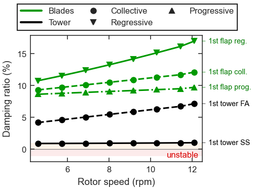

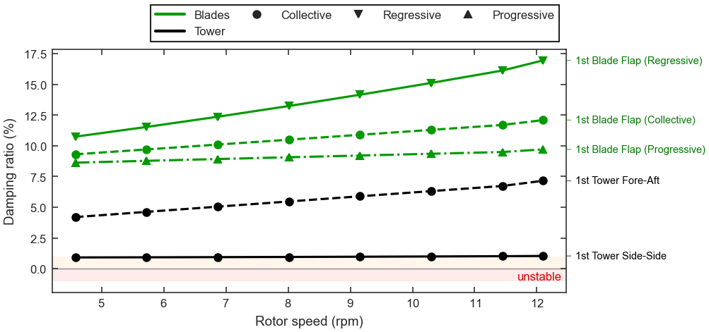

Frequency and damping panels
----------------------------

The Campbell diagram (a) and the damping ratio (b) on a shared rotor-speed axis, stacked
at single-column width and side by side at double-column width.

.. code-block:: python

   plot_campbell_panels(diagram, harmonics=(1, 3, 6), size="double")

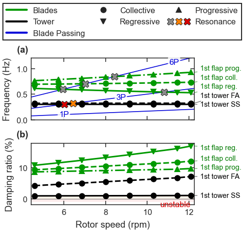

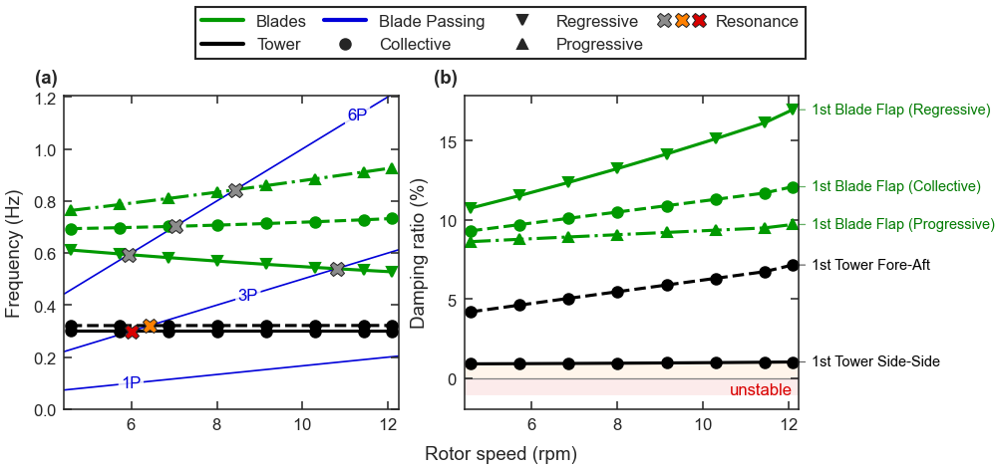

Mode participation
------------------

The signed participation of the most active degrees of freedom of the regressive
blade-flap mode at 8 m/s.

.. code-block:: python

   plot_mode_participation(
       solution, mode_index, top_n=5, short_names=True, size="single"
   )

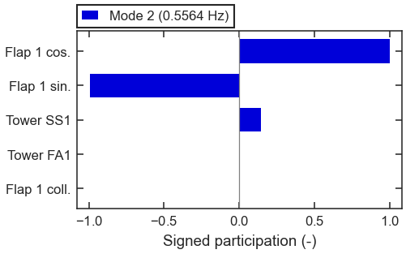

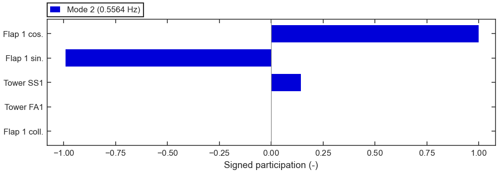

Phasor wheel
------------

The same mode's degrees of freedom as phasors: the cosine and sine flap coordinates a
quarter period apart, the signature of a whirling mode.

.. code-block:: python

   plot_mode_phasor_static(solution, mode_index, top_n=5, size="single")

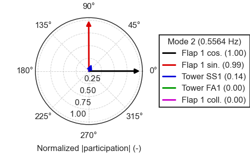

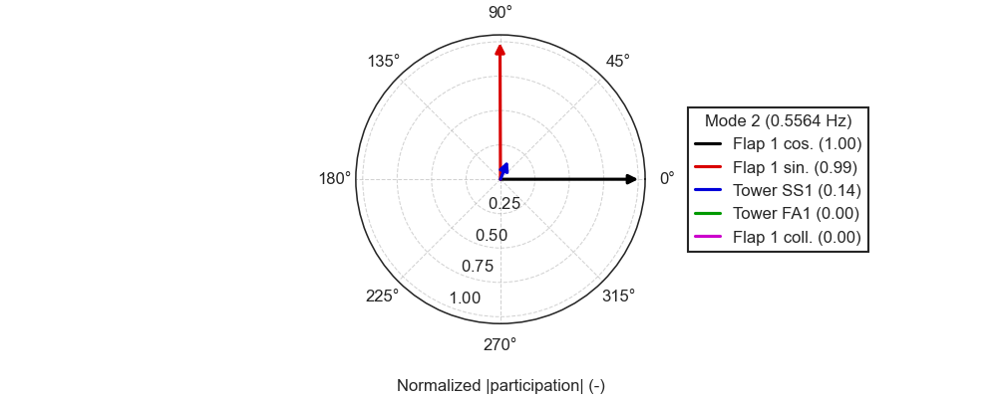

Multi-blade components
----------------------

How the mode's participation divides among the collective, cosine and sine
coordinates.

.. code-block:: python

   plot_blade_components_static(solution, mode_index, size="single")

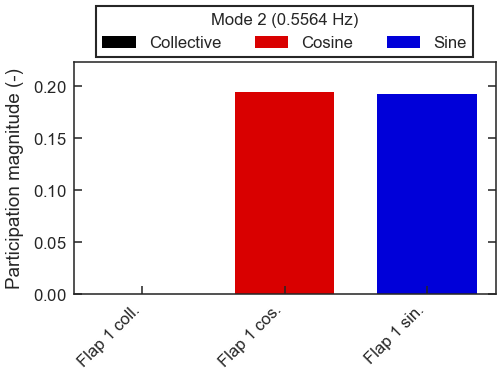

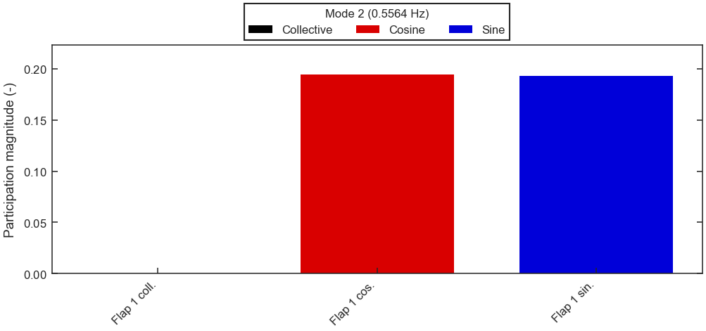

Complex mode shape in 3-D
-------------------------

Each degree of freedom as a stem to its complex component.

.. code-block:: python

   plot_mode_3d_static(solution, mode_index, top_n=5, size="single")

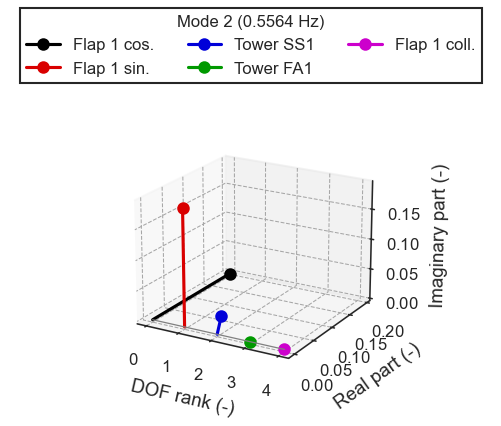

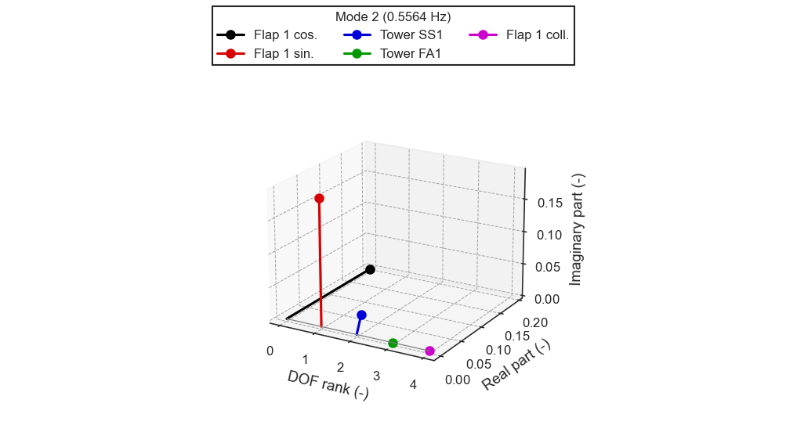

Whole-turbine mode shape
------------------------

A coupled platform-pitch, tower and flap mode of a floating turbine drawn on the
schematic semi-submersible geometry; the grey outline is the undeformed structure.

.. code-block:: python

   plot_mode_fowt_static(solution, mode_index, size="single")

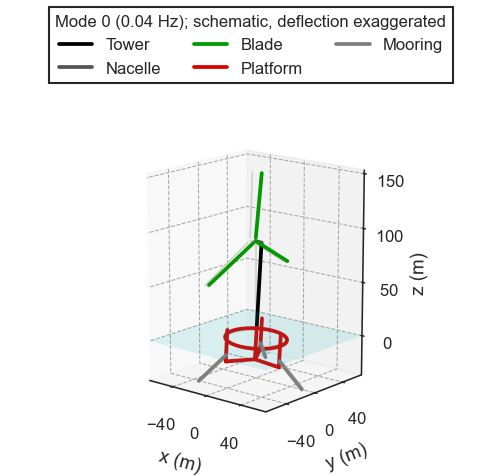

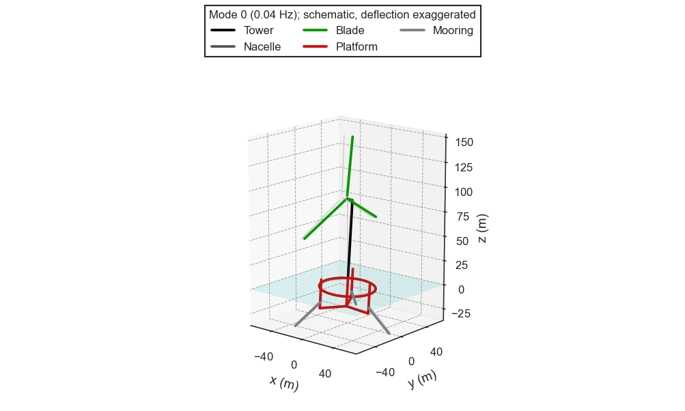

MAC matrix
----------

The modal assurance criterion between the modes of two adjacent operating points; the
diagonal shows that every mode tracks cleanly.

.. code-block:: python

   plot_mac_matrix_static(solutions[3], solutions[4], size="single")

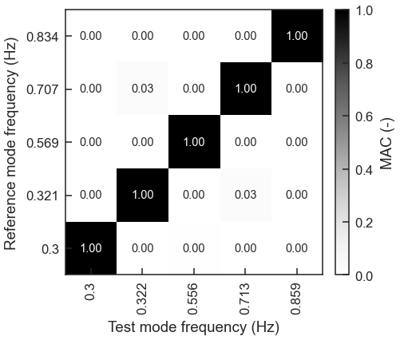

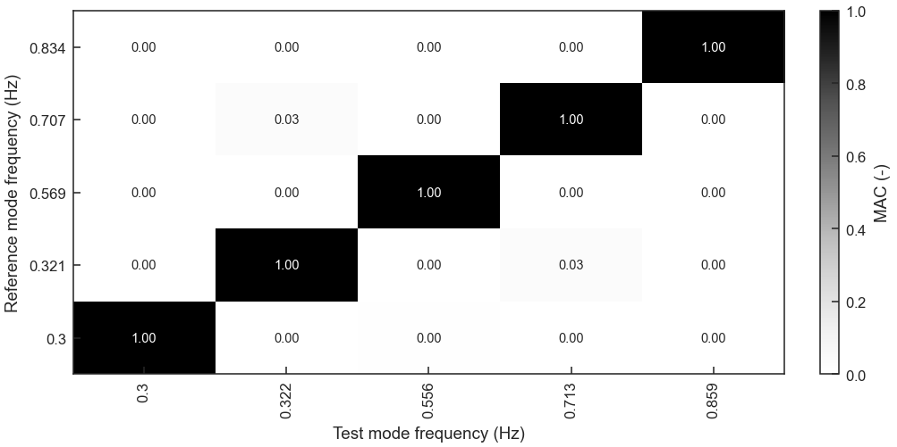

Tracking confidence
-------------------

The identification confidence of each track of the floating-turbine diagram, with the
ambiguous track in orange and the review threshold dashed.

.. code-block:: python

   plot_tracking_confidence_static(diagram, size="single")

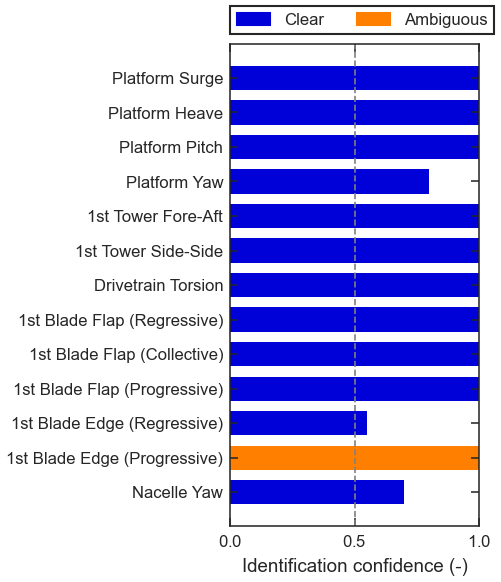

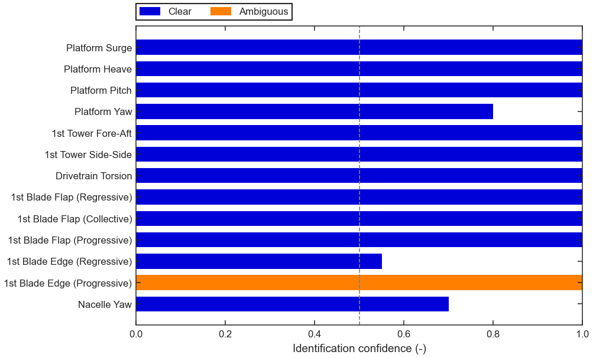

Azimuth coverage
----------------

The twelve azimuths sampled at each operating point of the study.

.. code-block:: python

   plot_azimuth_coverage_static(study.provenance, size="single")

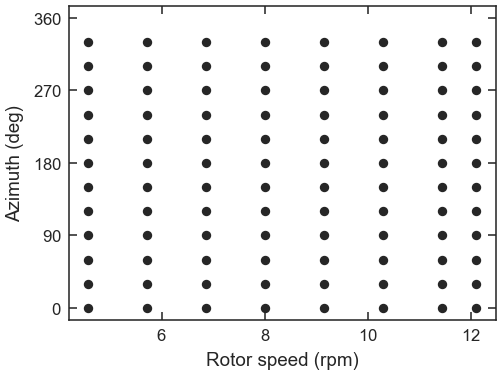

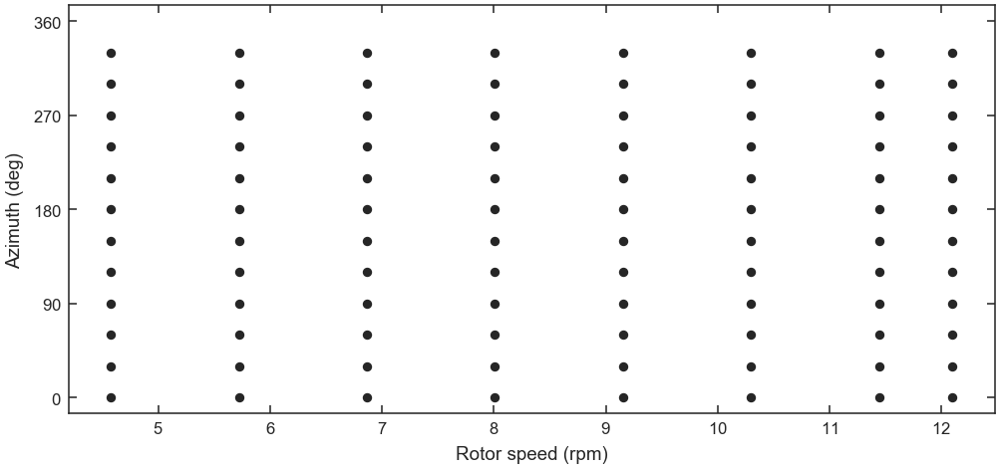

Branch review
-------------

A crossing of two modes found by the branch review, with the closest approach marked.

.. code-block:: python

   plot_branch_review_static(diagram, result.branch_groups, size="double")

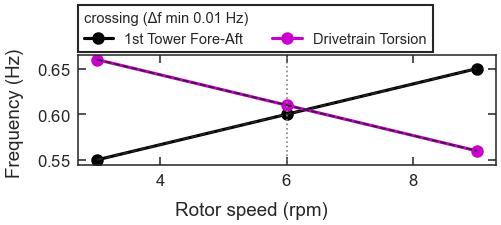

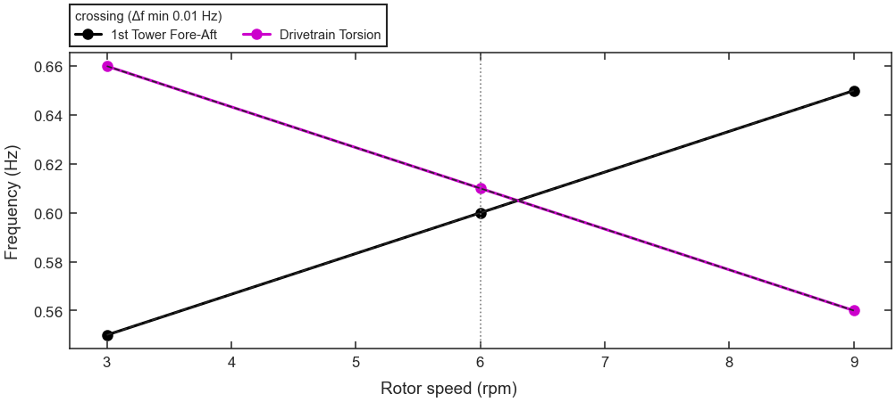

Load-versus-mode map
--------------------

The normalized contribution of each mode to each load output of the synthetic turbine
(tower-base and blade-root moments).

.. code-block:: python

   plot_load_mode_heatmap_static(qoi_map, size="single")

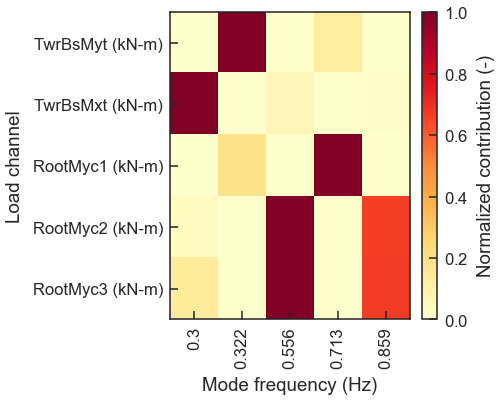

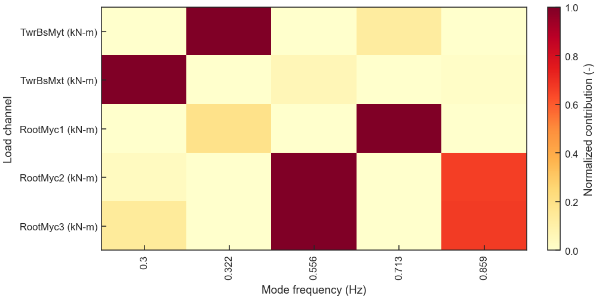
